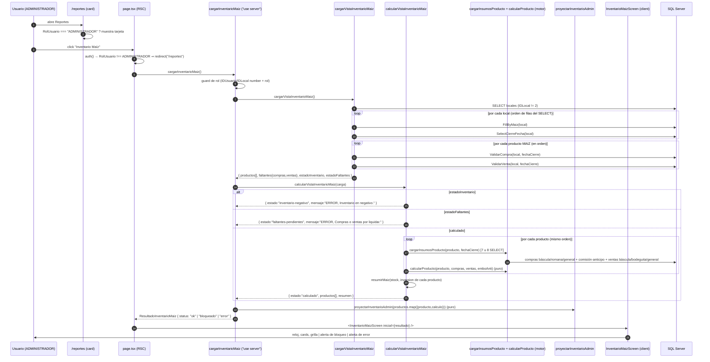

# Documentación — Reporte "Inventario Maíz" (`/reportes/cierre/inventario-maiz`)

> **Qué es este documento.** Describe, con el detalle suficiente para replicarlo 1:1, el reporte
> **Inventario Maíz** tal como está implementado hoy en este repositorio. Está pensado para que otro
> equipo lo reconstruya en un **sistema Next.js admin distinto que comparte la misma base SQL Server**,
> y que **no** tiene el motor de cierre de inventario (`app/(main)/cierre/inventario/`) que este
> reporte reutiliza. Por eso el documento incluye todo lo que el reporte **necesita de forma
> transitiva**: consultas SQL literales, mappers, motor de cálculo, proyección de grilla, estilos y
> componentes de UI.
>
> **Regla de oro.** Todo lo que aparece acá sale de leer el código del repositorio. Las consultas SQL
> están copiadas **verbatim** del código (incluidos los `${…}` de los tagged templates de Prisma, que
> son parámetros, no interpolación de texto). Donde algo no se puede determinar leyendo el código se
> escribe **`a confirmar`** en lugar de inventarlo.
>
> **Fuentes usadas.**
> - El código del reporte: `app/(main)/reportes/cierre/inventario-maiz/**`.
> - El código del motor reutilizado: `app/(main)/cierre/inventario/**` (solo las ramas que este
>   reporte ejecuta).
> - Decisiones de producto: `odd/tasks/cierre-reporte-maiz.md`, `odd/tasks/cierre-inventario.md`,
>   `odd/tasks/cierre-mejoras-grilla.md`, `app/(main)/cierre/PARIDAD-LEGACY.md`,
>   `app/(main)/reportes/cierre/inventario-maiz/README.md`, `app/(main)/cierre/inventario/README.md`.
> - Documentación legacy del módulo de cierres: `app/(main)/cierre/reporte/Documentacion-Reportes-*.md`
>   (describe los **reportes** de cierre, no esta vista admin).
>
> **Sobre el legacy WinForms.** El código C# (`FrmMenuAdmin`, `FrmCierreProductoCrear`,
> `ClassOperacionParaCierre`, `ClassCalculosInventario_Dgv`, `ClassSelectProductoFormula`,
> `ClassValidarCompraVenta`) **no está en este repositorio**. Las referencias a nombres de método y
> números de línea que aparecen acá provienen de los comentarios del port (que sí los citan) y de
> `odd/tasks/cierre-reporte-maiz.md`. Todo lo que dependa de leer el C# original está marcado
> **`a confirmar`**.
>
> **Estado:** documentación de solo lectura. No se modificó ninguna fuente.

---

## Índice

1. [Propósito y alcance](#1-propósito-y-alcance)
2. [Acceso y seguridad](#2-acceso-y-seguridad)
3. [Flujo completo end-to-end](#3-flujo-completo-end-to-end)
4. [Modelo de datos](#4-modelo-de-datos)
5. [Carga de datos — nivel 1 (sucursales, productos, cierre, faltantes)](#5-carga-de-datos--nivel-1-sucursales-productos-cierre-faltantes)
6. [Carga de datos — nivel 2 (insumos por producto)](#6-carga-de-datos--nivel-2-insumos-por-producto)
7. [Validaciones y bloqueos](#7-validaciones-y-bloqueos)
8. [Motor de cálculo](#8-motor-de-cálculo)
9. [Totales STOCK / PRECIO / INVERSION](#9-totales-stock--precio--inversion)
10. [Proyección de la grilla admin](#10-proyección-de-la-grilla-admin)
11. [DTO serializable](#11-dto-serializable)
12. [UI](#12-ui)
13. [Decisiones del usuario y diferencias vs legacy](#13-decisiones-del-usuario-y-diferencias-vs-legacy)
14. [Dependencias a replicar](#14-dependencias-a-replicar)
15. [Checklist de réplica + tests como casos de aceptación](#15-checklist-de-réplica--tests-como-casos-de-aceptación)
16. [Limitaciones, riesgos y "a confirmar"](#16-limitaciones-riesgos-y-a-confirmar)
- [Anexo A — Inventario de consultas SQL](#anexo-a--inventario-de-consultas-sql)
- [Anexo B — Todas las fórmulas en una página](#anexo-b--todas-las-fórmulas-en-una-página)
- [Anexo C — Glosario legacy ↔ web](#anexo-c--glosario-legacy--web)

---

## 1. Propósito y alcance

### 1.1 Qué resuelve

Una pantalla de **solo lectura** que muestra el **stock de maíz de todas las sucursales**, cada
sucursal calculada **en modo normal desde su propio último cierre**, con:

1. Tres totales agregados en cards arriba de la grilla: **STOCK**, **PRECIO** e **INVERSION**
   (en el legacy eran textboxes debajo de la grilla).
2. Una **grilla tipo DataGridView** con, por producto con movimiento del día, seis filas de detalle
   (`ANTERIOR`, `COMPRA`, `VENTA`, `EXCEDENTE`, `STOCK`, `UTILIDAD`) y, por producto sin movimiento,
   una fila resumen (`STOCK: / PRECIO: / INVERSION: / UTILIDAD: / UTI. QQ:`).
3. Dos **estados de bloqueo** que impiden el cálculo: inventario negativo y comprobantes por liquidar,
   con un diálogo de faltantes.

No escribe nada en la base: **no** pasa por el guardado del cierre (`_lib/guardar`), **no** genera
snapshot firmado (`_lib/snapshot`), **no** pide clave maestra y **no** usa el gate del menú de cierre.

### 1.2 Ruta y archivos

| Ruta | Archivo | Tipo | Rol |
|---|---|---|---|
| `/reportes/cierre/inventario-maiz` | `app/(main)/reportes/cierre/inventario-maiz/page.tsx` | Server Component (23 líneas) | Guard de rol + llamada a la acción + render |
| — | `_actions/inventario-maiz.ts` | `"use server"` (81 líneas) | `cargarInventarioMaiz()`: guard de rol, orquestación, traducción de errores a DTO |
| — | `_lib/cargar-vista.ts` | server-only (73 líneas) | Carga: sucursales → productos MAIZ por sucursal → fecha de cierre por sucursal → faltantes por producto |
| — | `_lib/calcular-vista.ts` | server-only (68 líneas) | Bloqueos (en el orden del legacy) + cálculo por producto + totales |
| — | `_lib/grilla/proyectar-inventario-admin.ts` | puro (199 líneas) | Proyección de filas de grilla (`InsertDgvInvProductoParaAdministrador`) |
| — | `_lib/tipos-dto.ts` | tipos (32 líneas) | `ResultadoInventarioMaiz` |
| — | `_components/inventario-maiz-screen.tsx` | `"use client"` (159 líneas) | Pantalla: reloj, cards, grilla, bloqueo, error |
| — | `README.md` | doc (60 líneas) | Resumen de propósito/reglas/decisiones |

Tests (Vitest), que son los casos de aceptación del §15.2:

| Test | Qué fija |
|---|---|
| `_actions/inventario-maiz.test.ts` | guard de rol, bloqueos, DTO `ok`, mapeo de errores |
| `_lib/cargar-vista.test.ts` | SQL de productos (`FillByMaiz`), orden por sucursal, fecha por sucursal, faltantes, estados |
| `_lib/calcular-vista.test.ts` | precedencia de bloqueos, uso de la variante normal, resumen |
| `_lib/grilla/proyectar-inventario-admin.test.ts` | las 9 + 3 filas, celdas exactas, estilos, formato `F` de COMPRA |

### 1.3 Origen legacy (cadena de llamadas)

```text
FrmMenuAdmin  →  BtnAdminInventarioMaiz_Click
                 └─ new FrmCierreProductoCrear(true)          // Estado = true  ("modo admin/maíz")
                       ├─ ClassOperacionParaCierre.TraerDatosLocalProducto
                       │    ├─ ClassSelectProductoFormula.TraerProductoFormulaMaiz
                       │    │    ├─ LocalID.TraerTodosLocalesID  → CbllenarTableAdapter.FillByTodasSinPiladoraSinMenu
                       │    │    ├─ ProductoFormulaInventarioTableAdapter.FillByMaiz(local)   (por sucursal)
                       │    │    └─ CADCierre.TraerFecha(local)  → CierreTableAdapter.SelectCierreFecha
                       │    ├─ ClassValidarCompraVenta.TraerCyVAdmin
                       │    └─ ClassOperacionParaCierre.EvaluarInventario
                       ├─ if (EstadoInventario)  → "ERROR, Inventario en negativo."        + return
                       ├─ if (EstadoFaltantes)   → "ERROR, Compras o ventas por liquidar." + return
                       ├─ ClassOperacionParaCierre.RealizarCalculosCierreParaAdministrador
                       ├─ ClassCalculosInventario_Dgv.InsertDgvInvProductoParaAdministrador
                       └─ ClassOperacionParaCierre.MostrarTextBoxParaAdministrador   // STOCK / PRECIO / INVERSION
```

Puntos del legacy que el port copia a propósito:

- La vista admin **no** tiene selector de sucursal: recorre **todas** las sucursales menos la 2.
- El cálculo por producto usa la variante **normal** de las consultas (sin corte de fecha
  administrativa), con el `CierreFecha` de **cada** producto.
- Los dos `if` de bloqueo son secuenciales con `return` adentro → **precedencia inventario > faltantes**
  y **un solo mensaje** por carga.
- `MostrarTextBoxParaAdministrador` suma los `InventarioNuevo` de **todos** los productos y divide
  inversión por stock con `catch → 0`.
- El link `LblComprobantes` (`--> COMPRAS O VENTAS POR LIQUIDAR`) es UI del mismo formulario y se
  muestra en **ambos** bloqueos. *(Verificado por el log de decisiones
  `odd/tasks/cierre-reporte-maiz.md`: "los dos bloqueos hacen `return`… y `LblComprobantes` se muestra
  en ambos". El `FrmCierreProductoCrear.cs` original no está en el repo → **`a confirmar`** contra el
  C#.)*

### 1.4 Qué NO es

- No es el **cierre de inventario** (`/cierre/inventario`): ese sí calcula, guarda y firma snapshot.
- No es la sección "Inventario de Maíz" del **Cierre PDF**
  (`/reportes/contabilidad/cierre-pdf`), que es **otra implementación** (lee valores **guardados** de
  `Cierre_Producto`, no recalcula). Ver §14.4.
- No exporta archivos: la copia a Excel es manual (Ctrl+C de la grilla, §12.4).
- No permite elegir sucursal ni fecha administrativa.

### 1.5 Vocabulario

| Término | Significado en este documento |
|---|---|
| **sucursal / local** | Fila de la tabla `Local`. `IDLocal` es la PK. Se excluye `IDLocal = 2`. |
| **cierre previo** | Última fila de `Cierre` de esa sucursal: `MAX(CI.Fecha)`. Su fecha se usa como corte inferior de todas las consultas del día. |
| **del día** | Todo lo registrado **después** del cierre previo (`> CAST(@fecha AS DATETIME)`), sin tope superior. |
| **qq** | Quintales. Se usa como sinónimo de "cantidad" en toda la grilla. |
| **producto MAIZ** | Fila de `Producto` con `Descripcion` **exactamente** `MAIZ` (§4.4). |
| **producto sucursal** | Rótulo de la grilla: `<Descripcion> <Local>`, p. ej. `MAIZ VENTANA PRINCIPAL` (§10.5). |
| **N2 / F** | Formatos de `System.Decimal.ToString`: `N2` = `1,234.57` (con separador de miles, 2 decimales); `F` = `1234.57` (sin separador, 2 decimales). Ver §8.1. |

---

## 2. Acceso y seguridad

### 2.1 Tarjeta en `/reportes`

`app/(main)/reportes/page.tsx` (Server Component) calcula los flags de visibilidad **una vez**:

```ts
const session = await auth()
const IDLocal = session?.user?.IDLocal ?? 0
const isAdmin = IDLocal === 1
// El reporte Inventario Maíz es de la vista admin del legacy: rol, no IDLocal.
const esRolAdmin = session?.user?.RolUsuario === "ADMINISTRADOR"
```

La tarjeta vive en la sección `"Cierre"` y es la **única** del archivo que usa `esRolAdmin`:

```ts
{
  title: "Inventario Maíz",
  description: "Stock de maíz de todas las sucursales desde el último cierre",
  href: "/reportes/cierre/inventario-maiz",
  icon: Wheat,
  visible: esRolAdmin,
}
```

Detalle importante para la réplica: en el resto de las tarjetas `isAdmin` significa **`IDLocal === 1`**
(Ventanas), no rol. Acá **no** se usa ese flag. Las tarjetas con `visible: false` se filtran
(`section.items.filter((i) => i.visible)`) y una sección sin items visibles no se renderiza.

### 2.2 Página

`page.tsx`:

```ts
export const dynamic = "force-dynamic"

export default async function InventarioMaizPage() {
  const session = await auth()
  if (session?.user?.RolUsuario !== "ADMINISTRADOR") {
    redirect("/reportes")
  }

  const resultado = await cargarInventarioMaiz()
  return <InventarioMaizScreen inicial={resultado} />
}
```

- `force-dynamic`: el reporte es consulta en vivo (reloj y stock del momento), nunca estático.
- El `redirect("/reportes")` es el guard de render: un usuario sin rol no ve nada de la página.
- **No hay `loading.tsx`** en la ruta ni estado de carga en el cliente: mientras el servidor ejecuta
  las consultas (§3.3), el navegador queda en la pantalla anterior.
- Además, `app/(main)/layout.tsx` hace `redirect("/login")` si no hay sesión, y `proxy.ts`
  (middleware de NextAuth con `matcher: ["/((?!_next/static|_next/image|favicon.ico|api/auth).*)"]`)
  bloquea a cualquier visitante no autenticado vía el callback `authorized` de `auth.config.ts`
  (`/login` es la única ruta permitida sin sesión).

### 2.3 Acción

`_actions/inventario-maiz.ts` — guard completo antes de tocar datos:

```ts
const MENSAJE_NO_ADMIN = "Solo administradores."

const session = await auth()
const user = session?.user
if (
  !user ||
  typeof user.IDUsuario !== "number" ||
  typeof user.IDLocal !== "number" ||
  user.RolUsuario !== "ADMINISTRADOR"
) {
  return { status: "error", error: MENSAJE_NO_ADMIN }
}
```

- Devuelve **`{ status: "error", error: "Solo administradores." }`** (no lanza excepción). El test
  `_actions/inventario-maiz.test.ts` verifica que con `RolUsuario: "OPERARIO"` y con `session === null`
  la respuesta es exactamente esa y que `cargarVista` / `calcularVista` **no** se invocan.
- La acción es un `"use server"` file: es un endpoint invocable. Un usuario autenticado sin rol puede
  llamarla, pero recibe el error tipado.
- **No valida** `IDLocal` contra nada: el reporte lee **todas** las sucursales por diseño (es la vista
  admin del legacy).

### 2.4 Campos de sesión disponibles

`types/next-auth.d.ts` declara en `Session.user` / `User` / `JWT`:
`IDUsuario: number`, `IDLocal: number`, `UsuarioRolId: number`, `RolUsuario: string`,
`NombreUsuario: string`, `Local: string`.

`auth.ts` los llena en `authorize` (desde `db.usuario.findFirst` + `db.local.findUnique`), los copia al
JWT en el callback `jwt` y al objeto de sesión en el callback `session`. El único campo que este
reporte usa es **`RolUsuario`** (y comprueba el tipo de `IDUsuario` / `IDLocal`).

### 2.5 Qué NO hay (comparado con `/cierre/inventario`)

| Control | `/cierre/inventario` | `/reportes/cierre/inventario-maiz` |
|---|---|---|
| Gate del menú de cierre (`_lib/gate`) | Sí | **No** |
| Clave maestra (token HMAC, cookie por propósito) | Sí | **No** |
| Snapshot firmado de lo calculado | Sí | **No** |
| Validación de sucursal contra el usuario | Sí | **No** (recorre todas) |
| Filtro por rol | No (gate distinto) | **Sí**, `RolUsuario === "ADMINISTRADOR"` |

### 2.6 Superficie de datos y brechas

- **Datos expuestos**: stock, precio, inversión y utilidad de todas las sucursales; nombres de
  clientes y códigos de comprobantes pendientes (diálogo de faltantes). La autorización es **solo por
  rol**, no por sucursal. Es exactamente el alcance que tenía la vista admin del legacy.
- **Rol desde el JWT**: `RolUsuario` viaja en el token; si a un usuario se le quita el rol, seguirá
  viendo el reporte hasta que su token se refresque / vuelva a iniciar sesión. `a confirmar` (depende
  de la configuración de expiración de NextAuth, no declarada en `auth.ts`).
- **Fuga de mensajes internos**: el `catch` genérico de la acción devuelve `error.message` al cliente
  (`No se pudo cargar: ${error.message}`). Un error inesperado de Prisma/SQL puede exponer texto
  interno. Ver §16.1-B.
- **Sin límite de costo**: un administrador puede provocar `N` consultas por carga (§3.3). No hay
  caché ni rate limit.

---

## 3. Flujo completo end-to-end

### 3.1 Diagrama



### 3.2 Paso a paso con archivos y funciones

| # | Quién | Qué hace | Archivo |
|---|---|---|---|
| 1 | RSC | `auth()` + `redirect` si el rol no es `ADMINISTRADOR` | `page.tsx` |
| 2 | acción | `auth()` + validación de tipos y rol; si falla devuelve `error` | `_actions/inventario-maiz.ts` |
| 3 | carga | `db.$queryRaw` de todas las sucursales ≠ 2 | `_lib/cargar-vista.ts` |
| 4 | carga | por sucursal: `traerProductosFormulaMaiz(idLocal)` y `traerFechaCierre(idLocal)` | `_lib/cargar-vista.ts` → `cierre/inventario/_lib/datos/consultas-productos.ts` |
| 5 | carga | por producto: `traerValidacionCompra` y `traerValidacionVenta` | `_lib/cargar-vista.ts` → `.../datos/consultas-validaciones.ts` |
| 6 | carga | calcula `estadoFaltantes` y `estadoInventario` | `_lib/cargar-vista.ts` |
| 7 | cálculo | corta si hay bloqueo (en ese orden) | `_lib/calcular-vista.ts` |
| 8 | cálculo | por producto: `cargarInsumosProducto(producto, fechaCierre)` | `.../datos/cargar.ts` |
| 9 | cálculo | por producto: `calcularProducto(...)` (compra del día → venta del día → pasarValoresACV) | `.../motor/calcular-producto.ts` |
| 10 | cálculo | `resumirMaiz` sobre `inventarioNuevo.stock` / `.inversion` | `.../sesion/mapeo-dto.ts` |
| 11 | acción | `proyectarInventarioAdmin` (dos pasadas) | `_lib/grilla/proyectar-inventario-admin.ts` |
| 12 | acción | serializa: `fechaConsulta = new Date().toISOString()` | `_actions/inventario-maiz.ts` |
| 13 | cliente | render: reloj, cards, grilla, bloqueo, error, "Actualizar" | `_components/inventario-maiz-screen.tsx` |

### 3.3 Conteo de consultas

Con `L` = cantidad de sucursales (`Local` con `IDLocal != 2`), `P` = cantidad de productos MAIZ con
fila en el último cierre de su sucursal, `E` = cantidad de productos cuyo `anticipo` o `embodegado`
del día resultó distinto de cero:

| Etapa | Consultas |
|---|---|
| Sucursales | `1` |
| Por sucursal | `2 × L` (`FillByMaiz` + `SelectCierreFecha`, **siempre**, aun sin productos MAIZ) |
| Faltantes | `2 × P` (una de compra + una de venta por producto) |
| Insumos (solo si no hay bloqueo) | `7 × P` + `1 × E` |
| **Total sin bloqueo** | `1 + 2L + 2P + 7P + E` |
| **Total con bloqueo** | `1 + 2L + 2P` |

Ejemplo del smoke conocido (4 sucursales con MAIZ, 3 sin MAIZ, 7 sucursales en total → `L = 7`):
`1 + 14 + 2×4 + 7×4 + E = 51 + E` consultas. Marcado como **cálculo derivado**, no medido.

Las consultas de insumos se emiten en **dos tandas** con `Promise.all`
(`_lib/datos/cargar.ts`, `cargarInsumos`): primero `[comprasBáscula, comprasRomana, comprasGeneral,
emboAnti]`, después `[ventasBáscula, ventasBodeguita, ventasGeneral]`. La 8.ª (`traerCompraEmbodegado`)
se emite después y solo si `anticipo != 0 || embo != 0`.

### 3.4 Invariantes de orden (replicar sí o sí)

1. Las sucursales se iteran en el **orden de filas que devuelve SQL Server**; la consulta de locales
   **no tiene `ORDER BY`**. Ese orden define el orden de los productos y, por lo tanto, el orden de la
   grilla.
2. Por sucursal, **primero** los productos y **después** la fecha de cierre.
3. La fecha de cierre se consulta para **todas** las sucursales, incluso las que no tienen MAIZ.
4. Las validaciones de faltantes se vuelven a consultar por **cada producto**, y las listas se
   **acumulan** entre productos (no se deduplican).
5. El orden de las filas del bloque COMPRAS y VENTAS dentro de la grilla es el orden de los productos
   (ver §10.2).
6. El motor suma en el orden de las filas devueltas por cada consulta (sin `ORDER BY`) y concatena
   `compras = báscula ++ romana ++ general` y `ventas = báscula ++ bodeguita ++ general`
   (`.../datos/cargar.ts`). Con sumas decimales exactas el orden no cambia el resultado; se documenta
   para fidelidad.

---

## 4. Modelo de datos

### 4.1 Tablas y columnas usadas

Tipos tomados de `prisma/schema.prisma`.

#### `Local`

| Columna | Tipo Prisma | Uso en este reporte |
|---|---|---|
| `IDLocal` | `Int` (PK, autoincrement) | Lista de sucursales; se **excluye** `2` |
| `Local` | `String?` `@db.NVarChar(Max)` | Se selecciona como alias `Sucursal` (en la práctica **no se usa** desde la consulta de locales, ver §5.1) |

#### `Producto`

| Columna | Tipo Prisma | Uso |
|---|---|---|
| `IDProducto` | `Int` (PK) | Identidad del producto |
| `IDLocal` | `Int?` | Join `P.IDLocal = L.IDLocal` |
| `Descripcion` | `String?` `@db.NVarChar(Max)` | Filtro `= 'MAIZ'` y rótulo de la grilla |
| `HumedadSeco` | `String?` `@db.NVarChar(50)` | Fórmula de `precioDelDia` (compra) |
| `MermaAgua` | `String?` `@db.NVarChar(50)` | Fórmula de `precioDelDia` (compra) y de `porcentajeTotal` (venta) |
| `ServBasico` | `String?` `@db.NVarChar(50)` | Fórmula de `precioDelDia` (compra) |
| `Precio` | `String?` `@db.NVarChar(50)` | Se carga, **no se usa** en este camino |
| `PrecioMinimo` | `String?` `@db.NVarChar(50)` | Solo en la rama MM (**no alcanzada**, §8.5) |
| `PrecioMaximo` | `String?` `@db.NVarChar(50)` | Solo en la rama MM (**no alcanzada**) |
| `Estado` | `Boolean?` | `WHERE P.Estado = 1` |
| `EstadoMM` / `MMHumedadSeco` / `MMMermaAguna` / `MMServBasico` / `MMPrecio` | `Boolean?` / `String?` ×4 | **No** se seleccionan en `FillByMaiz`; el mapper fuerza `mmEstado=false` y `MM*=0` |

#### `Cierre`

| Columna | Tipo | Uso |
|---|---|---|
| `IdCierre` | `Int` (PK) | Join con `Cierre_Producto` |
| `IdLocal` | `Int?` | Filtro por sucursal |
| `Fecha` | `DateTime?` `@db.DateTime` | `MAX(CI.Fecha)` = cierre previo; corte inferior de todas las consultas del día |

#### `Cierre_Producto` (valores guardados como **texto**)

| Columna | Tipo | Uso |
|---|---|---|
| `IdCierre` | `Int?` | Join |
| `IDProducto` | `Int?` | Join |
| `Cantidad` | `String?` `@db.NVarChar(100)` | `STOCK` (quintales del cierre previo) |
| `Precio` | `String?` `@db.NVarChar(100)` | `STOCK_PRECIO` (precio promedio del cierre previo) |
| `Inversion` | `String?` `@db.NVarChar(100)` | `STOCK_INVERSION` |
| `UtilidadQQ` | `String?` `@db.NVarChar(100)` | Se carga, **no se usa** |
| `UtilidadTotal` | `String?` `@db.NVarChar(100)` | Se carga, **no se usa** |
| `PrecioDia` | `String?` `@db.NVarChar(100)` | Se carga, **no se usa** |
| `Humedad` | `String?` `@db.NVarChar(100)` | Se carga, **no se usa** |
| `Impureza` | `String?` `@db.NVarChar(100)` | Se carga, **no se usa** |

#### Compras

| Tabla | Columnas usadas |
|---|---|
| `Compra_Liquidacion` | `IDBoletoDetalle` (PK), `Precio` `Decimal(18,6)`, `PesoNeto` `Decimal(18,2)`, `ValorTotal` `Decimal(18,2)`, `Retencion` `Decimal(18,2)`, `Fecha_Edit` `DateTime?` |
| `Compra_Liquidacion_Comprobante` | `IDBoletoDetalle` (PK), `CodComprobante` `NVarChar(15)` |
| `Compra_Liquidacion_Cheque` (no usada), `Compra_Liquidacion_Retencion` (no usada) | — |
| `CompraBoletoDetalle` | `IDBoletoDetalle` (PK), `IDLocal`, `IDCliente`, `IDProducto`, `Codigo` `Int?`, `CodDia` `Int?`, `Humedad` `Decimal(18,2)`, `Impureza` `Decimal(18,2)` |
| `CompraBoletoEntrada` | `IDBoletoDetalle` (PK), `Fecha` |
| `CompraBoletoSalida` | `IDBoletoDetalle` (PK), `Fecha` |
| `Compra_Almacenaje` | `IDBoletoDetalle`, `IDRomana`, `IDCompraGeneral`, `Precio` `Decimal(18,6)`, `ValorTotalComision` `Decimal(18,2)`, `ValorTotal` `Decimal(18,2)`, `Porcentaje` `Decimal(18,6)`, `Merma` `Decimal(18,2)`, `Neto` `Decimal(18,2)` |
| `Compra_Transaccion_Pago_Efectivo` | `IdBoletoDetalle`, `CantidadParcial` `Decimal(18,2)`, `Anticipo` `Boolean?` |
| `Compra_Transaccion_Pago_Cheque` | `IdBoletoDetalle`, `CantidadParcial`, `Anticipo` |
| `Compra_Transaccion_Pago_Transferencia` | `IdBoletoDetalle`, `CantidadParcial` |
| `Romana` | `IDRomana` (PK), `IDProducto`, `Humedad` `Decimal(18,2)`, `Impureza` `Decimal(18,2)` |
| `RomanaComprobante` | `IDRomana` (PK), `RetencionReal` `Decimal(10,2)`, `Efectivo` `Decimal(10,2)`, `Cheque` `Decimal(10,2)`, `FechaHoraPago` `DateTime?` |
| `AlmacenamientoCompra` | `IDRomana`, `IDCompraGeneral`, `PesoPagar` `Decimal(18,6)`, `Neto` `Decimal(18,2)`, `Porcentaje` `Decimal(18,6)`, `Merma` `Decimal(18,2)`, `Precio` `Decimal(18,6)`, `ValorTotal` `Decimal(18,2)` |
| `CompraGeneral` | `IDCompraGeneral` (PK), `IDProducto`, `Humedad` `Decimal(18,2)`, `Impureza` `Decimal(18,2)`, `Precio` `Decimal(18,8)`, `Quintales` `Decimal(18,8)`, `Efectivo` `Decimal(18,8)`, `Cheque` `Decimal(18,8)`, `FechaHora` `DateTime?` |
| `Cierre_Producto_Operacion_Compra_Bascula` / `_Romana` / `_General` | `IdBoletoDetalle` — exclusión "ya incluido en un cierre" |

#### Ventas

| Tabla | Columnas usadas |
|---|---|
| `CobroComprobanteVenta` | `IDBoletoEntradaVenta`, `Precio` `Decimal(18,8)`, `RetencionReal` `Decimal(18,2)`, `Efectivo` `Decimal(18,2)`, `Deposito` `Decimal(18,2)`, `Cheque` `Decimal(18,2)`, `Pendiente` `Decimal(18,2)`, `FechaHoraPago` `DateTime?` |
| `BoletoEntradaVenta` | `IDBoletoEntradaVenta` (PK), `IDLocal`, `IDCliente`, `IDProducto`, `CodSalida` `NVarChar(50)`, `CodDia` `NVarChar(50)`, `Humedad` `Decimal(8,2)`, `Impureza` `Decimal(8,2)` |
| `BoletoSalidaVenta` | `IDBoletoEntradaVenta`, `FechaHora` |
| `AlmacenamientoVenta` | `IDBoletoEntradaVenta` `NVarChar(50)`!, `IDVentaGeneral`, `IDBodeguitaVenta`, `PesoPagar` `Decimal(18,8)`, `DiferenciaH` `Decimal(18,8)`, `Impureza` `Decimal(8,3)` |
| `VentaBodeguita` | `IDVentaBodeguita` (PK), `IDProducto`, `Humedad` `Decimal(18,8)`, `Precio` `Decimal(18,8)`, `Efectivo`, `Cheque`, `Transferencia`, `Deposito`, `NotaDebito` (`Decimal(18,8)`), `FechaHora` |
| `VentaGeneral` | `IDVentaGeneral` (PK), `IDProducto`, `Humedad` `Decimal(18,2)`, `Precio` `Decimal(18,2)`, `Efectivo`, `Cheque`, `Deposito`, `RetencionReal`, `FechaHora` |
| `Cierre_Producto_Operacion_Venta_Bascula` / `_Bodeguita` / `_General` | `IdBoletoDetalle` — exclusión "ya incluido en un cierre" |

#### Clientes

| Tabla | Columnas |
|---|---|
| `Cliente` | `IDCliente` (PK), `NombreCompleto` `NVarChar(Max)` (puede ser `NULL` → rompe la carga, §5.6) |

### 4.2 Joins, tal como están

No se usan relaciones de Prisma: **todas** las consultas son SQL crudo con `db.$queryRaw` (tagged
template). Los joins relevantes:

- `FillByMaiz`: `Producto P INNER JOIN [Local] L ON P.IDLocal = L.IDLocal` y
  `Cierre CI INNER JOIN Cierre_Producto CP ON CP.IdCierre = CI.IdCierre INNER JOIN Producto P ON
  P.IDProducto = CP.IDProducto`, y al final `A INNER JOIN C ON A.IDProducto = C.IDProducto`. Es decir:
  **el producto tiene que existir en la tabla `Producto` de esa sucursal y tener además fila en el
  último `Cierre` de esa sucursal**. Un MAIZ sin fila de cierre simplemente no aparece.
- `ValidarCompra`: `CompraBoletoDetalle → CompraBoletoSalida` **por `IDBoletoDetalle`** (las dos tablas
  están keyed por `IDBoletoDetalle`) `→ Cliente → Producto → Local`.
- `ValidarVenta`: `BoletoEntradaVenta → BoletoSalidaVenta` por `IDBoletoEntradaVenta` `→ Producto →
  Cliente → Local`.
- Compras/ventas del día: cada consulta arma sus propios CTE (`CBASCULA`, `EFEC`, `CHE`, `TRANSF`) y
  hace `LEFT JOIN` contra los pagos para que un comprobante sin pago no desaparezca.

### 4.3 Significado de la exclusión de la sucursal 2

`SELECT … FROM [Local] L WHERE L.IDLocal !=2` es el SQL de `CbllenarTableAdapter.FillByTodasSinPiladoraSinMenu`
(según el comentario de `_lib/cargar-vista.ts` y de `.../datos/consultas-sucursales.ts`). En el legacy,
`ClassSelectProductoFormula.TraerProductoFormulaMaiz` llama primero a `LocalID.TraerTodosLocalesID()`,
que ejecuta esa consulta.

Interpretación (según el nombre del método legacy y el comentario del código): la sucursal `2` es la
**piladora**, que no lleva cierre de producto y por eso queda fuera. **`a confirmar`**: el repo no
tiene datos ni documentación que confirmen que `IDLocal = 2` sea la piladora; solo el nombre del
TableAdapter (`…SinPiladoraSinMenu`). Nota: la **misma** consulta se usa en
`.../datos/consultas-sucursales.ts` para el combo del cierre (rol `ADMINISTRADOR`), lo que refuerza la
lectura.

Consecuencia práctica: si en la base `IDLocal = 2` no existe, la consulta devuelve todas las
sucursales; si existe, esa sucursal **nunca** entra al reporte ni a los totales.

### 4.4 Filtro de producto "MAIZ" exacto

```sql
WHERE A.PRODUCTO = 'MAIZ'
```

- Se aplica al final de `FillByMaiz`, sobre el alias `A.PRODUCTO` (= `Producto.Descripcion`).
- Es comparación de **igualdad de texto completo**: `MAIZ CLASE B`, `MAIZ QUEMADO`, `MAIZ B`, `MAIZ C`
  **no** entran. Es una decisión de usuario explícita (§13), copiada del legacy.
- Sensibilidad a mayúsculas/acentos y a espacios: depende de la **collation** de la columna en SQL Server
  (no documentada en el repo) → **`a confirmar`**. Con una collation habitual (`…_CI_AS`), `'Maiz'`
  también matchearía. Nota: en SQL Server, para `nvarchar` la comparación `=` **ignora los espacios
  finales**, así que `'MAIZ   '` iguala a `'MAIZ'`; `'MAIZ CLASE B'` no.

### 4.5 Último cierre por sucursal

El CTE `C` de `FillByMaiz` (§5.2) selecciona las filas de `Cierre_Producto` cuyo `Cierre.Fecha` es
igual al siguiente subquery (fragmento literal del `WHERE CI.IdLocal = ${idLocal} AND P.Estado = 1 AND
CI.Fecha = (…)`):

```sql
	SELECT MAX(CI.Fecha) FECHA
	FROM Cierre CI
	INNER JOIN Producto P ON P.IDLocal = CI.IdLocal
	WHERE CI.IdLocal = ${idLocal} AND P.Estado = 1
```

Notas de fidelidad:

- El subquery **no** filtra `P.IDProducto = CP.IDProducto`; solo verifica que la sucursal tenga algún
  producto activo. Es un `EXISTS` disfrazado.
- **Sin desempate**: si dos cierres de la misma sucursal comparten `MAX(Fecha)`, el `=` matchea ambos y
  el CTE devuelve **dos filas por producto**. El port lo copia (documentado en
  `app/(main)/cierre/PARIDAD-LEGACY.md`: "Si dos cierres comparten `MAX(Fecha)`, el CTE legacy de
  productos duplica la lista"). Consecuencia en este reporte: el producto aparece **dos veces** en la
  grilla y **se suma dos veces** en los totales.
- La fecha que usa el motor para el corte es la de `traerFechaCierre`, que es el **mismo** `MAX(CI.Fecha)`
  (consulta separada, `SELECT MAX(CI.Fecha) Fecha FROM Cierre CI WHERE CI.IdLocal = @idLocal`). Las dos
  consultas podrían devolver valores distintos si la base cambia entre ambas (ventana de carrera
  teórica).

### 4.6 Columnas `nvarchar` que contienen números

`Producto.HumedadSeco/MermaAgua/ServBasico/Precio/PrecioMinimo/PrecioMaximo` son `nvarchar(50)` y
`Cierre_Producto.Cantidad/Precio/Inversion/UtilidadQQ/UtilidadTotal/PrecioDia/Humedad/Impureza` son
`nvarchar(100)`. El legacy las leía como `string` y las convertía con `Convert.ToDecimal(string)`.

El port **no** hace `CONVERT` en estas dos consultas: los valores llegan como texto y se parsean con
`CsDecimal.parse` (`decimalDeTexto`), lo que **conserva la escala** (`"120.5000"` → escala 4). Esto es
intencional: Prisma convierte `Decimal` de SQL a `decimal.js` y **pierde la escala** (`5.00` → `5`).

---

## 5. Carga de datos — nivel 1 (sucursales, productos, cierre, faltantes)

Archivo: `app/(main)/reportes/cierre/inventario-maiz/_lib/cargar-vista.ts` (server-only, no es un
`"use server"`).

**Ejecución del SQL.** Todas las consultas usan `db.$queryRaw` con **tagged template** (nunca
`$queryRawUnsafe`), importado de `@/lib/db`:

```ts
// lib/db.ts
export const db = globalForPrisma.prisma ?? new PrismaClient()
```

Los `${valor}` de cada template se envían como **parámetros** (no se interpolan en el texto SQL); por
eso el SQL de la base es siempre la constante literal con placeholders. No hay `prisma.$transaction`, ni
caché, ni `revalidate`.

Contrato de salida:

```ts
export type ProductoCierreMaiz = {
  producto: DatoProducto
  /** CierreFecha of Dato_Producto: the closing date of the product's own local. */
  fechaCierre: Date
}

export type CargaVistaInventarioMaiz = {
  productos: ProductoCierreMaiz[]
  faltantes: { compras: DatoValidacionCyV[]; ventas: DatoValidacionCyV[] }
  estadoInventario: boolean
  estadoFaltantes: boolean
}
```

Orden exacto del cuerpo (`cargarVistaInventarioMaiz`, 73 líneas):

```text
1. filasLocales = SELECT locales
2. for (filaLocal of filasLocales):
     idLocal = entero(filaLocal.IDLocal, "IDLocal", { consulta: CONSULTA_LOCALES })
     productosLocal = traerProductosFormulaMaiz(idLocal)
     fechaCierre    = traerFechaCierre(idLocal)          // SIEMPRE, aunque no haya productos
     for (producto of productosLocal) productos.push({ producto, fechaCierre })
3. for ({producto, fechaCierre} of productos):
     compras.push(...traerValidacionCompra(producto.idLocal, fechaCierre))
     ventas.push(...traerValidacionVenta(producto.idLocal, fechaCierre))
4. return { productos, faltantes, estadoFaltantes, estadoInventario }
```

`CONSULTA_LOCALES` (constante de contexto de error, usada solo para mensajes):

```ts
const CONSULTA_LOCALES = "CbllenarTableAdapter.FillByTodasSinPiladoraSinMenu (Anexo A §A.B)"
```

### 5.1 Consulta de sucursales

`_lib/cargar-vista.ts`, inline (no reutiliza `listarSucursales`):

```ts
const filasLocales = await db.$queryRaw<{ IDLocal: number | null; Sucursal: string | null }[]>`
SELECT L.IDLocal , L.[Local] Sucursal
FROM [Local] L
WHERE L.IDLocal !=2`
```

- **Parámetros**: ninguno.
- **`ORDER BY`**: no tiene. El orden es el que devuelve SQL Server.
- **Mapper**: solo `entero(row.IDLocal, "IDLocal", ctx)`. La columna `Sucursal` se selecciona pero
  **no se valida ni se usa** (dato curioso: si `Local.Local` fuera `NULL`, esta consulta no falla; el
  rótulo de la grilla viene del `FillByMaiz`, §5.2).
- **Error de tipo**: si `IDLocal` viniera `NULL` o no numérico → `CargaCierreError` con código
  `NULL_COLUMN` / `UNEXPECTED_TYPE`, columna `IDLocal`, consulta `CbllenarTableAdapter…`.

### 5.2 Productos MAIZ de una sucursal — `FillByMaiz`

`app/(main)/cierre/inventario/_lib/datos/consultas-productos.ts` → `traerProductosFormulaMaiz(idLocal)`.
Comentario de cabecera del código: "`ProductoFormulaInventarioTableAdapter.FillByMaiz` (Anexo A §A.A)
verbatim".

```sql
WITH A AS ( SELECT IDProducto, L.IDLocal, L.[Local] Sucursal, Descripcion PRODUCTO,
CASE WHEN HumedadSeco IS NULL THEN '0' ELSE HumedadSeco END HUMEDAD_SECO,
CASE WHEN MermaAgua IS NULL THEN '0' ELSE MermaAgua END MERMA_AGUA,
CASE WHEN ServBasico IS NULL THEN '0' ELSE ServBasico END SERV_BASICO,
CASE WHEN Precio IS NULL THEN '0' ELSE Precio END PRECIO,
CASE WHEN PrecioMinimo IS NULL THEN '0' ELSE PrecioMinimo END PRECIO_MINIMO,
CASE WHEN PrecioMaximo IS NULL THEN '0' ELSE  PrecioMaximo END PRECIO_MAXIMO
FROM   Producto P
INNER JOIN [Local] L ON P.IDLocal = L.IDLocal
WHERE L.IDLocal = ${idLocal} AND  P.Estado = 1
),  C AS (
	SELECT CI.IdCierre, CP.IDProducto, CP.Cantidad STOCK, CP.Precio STOCK_PRECIO, CP.Inversion STOCK_INVERSION, CP.UtilidadQQ, CP.UtilidadTotal, CP.PrecioDia, CP.Humedad, CP.Impureza
	FROM Cierre CI
	INNER JOIN Cierre_Producto CP ON CP.IdCierre = CI.IdCierre
	INNER JOIN Producto P ON P.IDProducto = CP.IDProducto
	WHERE CI.IdLocal = ${idLocal} AND P.Estado = 1 AND CI.Fecha = (
	SELECT MAX(CI.Fecha) FECHA
	FROM Cierre CI
	INNER JOIN Producto P ON P.IDLocal = CI.IdLocal
	WHERE CI.IdLocal = ${idLocal} AND P.Estado = 1
	)
)
SELECT A.IDProducto, A.IDLocal, A.Sucursal, A.PRODUCTO,
A.HUMEDAD_SECO, A.MERMA_AGUA, A.SERV_BASICO, A.PRECIO, A.PRECIO_MINIMO, A.PRECIO_MAXIMO,
C.STOCK, C.STOCK_PRECIO, C.STOCK_INVERSION, C.UtilidadQQ, C.UtilidadTotal, C.PrecioDia, C.Humedad, C.Impureza
FROM A INNER JOIN C ON A.IDProducto =  C.IDProducto
WHERE A.PRODUCTO = 'MAIZ'
```

- **Parámetros**: `${idLocal}` **tres veces** (en orden textual: `WHERE L.IDLocal = ?`, `WHERE
  CI.IdLocal = ?`, `WHERE CI.IdLocal = ?` del subquery). Prisma los envía como parámetros posicionales.
- **Sin `ORDER BY`**.
- **No** selecciona columnas MM (`EstadoMM`, `MMHUMESECO`, `MMMERMAAGUA`, `MMSERVIBASICO`, `MMPRECIO`).
  El test `cargar-vista.test.ts` lo fija: `expect(sqlProductos).not.toContain("EstadoMM")` y
  `not.toContain("MMHUMESECO")`.
- Resultado esperado por el mapper: `DatoProducto[]` (§5.5.1).

### 5.3 Fecha de cierre de una sucursal — `SelectCierreFecha`

`.../datos/consultas-productos.ts` → `traerFechaCierre(idLocal)`:

```sql
SELECT MAX(CI.Fecha) Fecha
FROM Cierre CI
WHERE CI.IdLocal = ${idLocal}
```

- **Parámetros**: `${idLocal}` (1).
- **Mapper** (`mapearFechaCierre` en `.../datos/mapeador-producto-formula.ts`):
  - sin filas (`filas[0] === undefined`) → lanza **`CargaCierreSinCierrePrevio`**;
  - `Fecha === null` → lanza **`CargaCierreSinCierrePrevio`**;
  - si no es `Date` → `CargaCierreError` `UNEXPECTED_TYPE`;
  - si es `Date` → se devuelve **tal cual**, sin reformatear (se usa después como parámetro `datetime` en
    todas las consultas del día).
- **La fecha se consulta para todas las sucursales**, tenga o no productos MAIZ. Una sucursal sin
  ningún cierre **aborta todo el reporte** (comportamiento heredado: en el legacy la carga se caía).
  Esto está cubierto por el test: *"un local sin cierre previo crashea igual que el legado
  (SIN_CIERRE_PREVIO), aunque no tenga MAIZ"*.

### 5.4 Faltantes por liquidar — `TraerCyVAdmin`

`.../datos/consultas-validaciones.ts`. Se ejecutan **por producto** (dos consultas por producto), con
`producto.idLocal` y el `fechaCierre` de ese producto; las listas se acumulan.

#### 5.4.1 `traerValidacionCompra` — `ValidarCompraTableAdapter.GetData`

```sql
SELECT CBD.IDBoletoDetalle, L.[Local] Sucursal,  CONVERT(NVARCHAR, CBD.Codigo) + '-' + CONVERT(NVARCHAR, CBD.CodDia) CODIGO, P.Descripcion PRODUCTO, C.NombreCompleto CLIENTE, CBS.Fecha FECHA
  FROM CompraBoletoDetalle CBD
  INNER JOIN CompraBoletoSalida CBS ON CBD.IDBoletoDetalle = CBS.IDBoletoDetalle
  INNER JOIN Cliente C ON CBD.IDCliente = C.IDCliente
  INNER JOIN Producto P ON CBD.IDProducto = P.IDProducto
  INNER JOIN [Local] L ON L.IDLocal = CBD.IDLocal
  WHERE CBD.IDLocal = ${idLocal} AND CONVERT(DATE, CBS.Fecha) > CAST(${fecha} AS DATETIME)
  AND CBD.IDBoletoDetalle  NOT IN  (
	SELECT CL.IDBoletoDetalle
	FROM Compra_Liquidacion CL
	INNER JOIN CompraBoletoDetalle CBD ON CBD.IDBoletoDetalle = CL.IDBoletoDetalle
	WHERE CBD.IDLocal = ${idLocal} AND CONVERT(DATE, CL.Fecha)> CAST(${fecha} AS DATETIME)
  )
```

- **Parámetros**, en orden textual: `idLocal`, `fecha`, `idLocal`, `fecha`.
- **Sin `ORDER BY`**.
- El join con `CompraBoletoSalida` es por `IDBoletoDetalle` (la misma PK en ambas tablas), así que no
  aporta ninguna columna nueva más allá de `Fecha`; la consulta depende de que exista la fila de
  salida (es un `INNER JOIN`).

#### 5.4.2 `traerValidacionVenta` — `ValidarVentaTableAdapter.GetData`

```sql
SELECT BEV.IDBoletoEntradaVenta IDBoletoDetalle, L.[Local] SUCURSAL,  CONVERT(NVARCHAR, BEV.CodSalida) + '-' +  CONVERT(NVARCHAR, BEV.CodDia) CODIGO,
  P.Descripcion PRODUCTO, C.NombreCompleto CLIENTE, BSV.FechaHora FECHA
	   FROM BoletoEntradaVenta BEV
	   INNER JOIN BoletoSalidaVenta BSV ON BEV.IDBoletoEntradaVenta = BSV.IDBoletoEntradaVenta
	   INNER JOIN Producto AS P ON BEV.IDProducto = P.IDProducto
	   INNER JOIN Cliente C ON C.IDCliente = BEV.IDCliente
	   INNER JOIN [Local] L ON L.IDLocal = BEV.IDLocal
       WHERE BEV.IDLocal = ${idLocal}  AND BSV.FechaHora > CAST(${fecha} AS DATETIME) AND BEV.IDBoletoEntradaVenta NOT IN
       (
	   SELECT CCV.IDBoletoEntradaVenta
       FROM CobroComprobanteVenta CCV
	   INNER JOIN BoletoEntradaVenta AS BEV ON BEV.IDBoletoEntradaVenta = CCV.IDBoletoEntradaVenta
	   WHERE BEV.IDLocal = ${idLocal} AND CCV.FechaHoraPago > CAST(${fecha} AS DATETIME)
	   )
```

- **Parámetros**, en orden textual: `idLocal`, `fecha`, `idLocal`, `fecha`.
- **Alias `SUCURSAL` en mayúsculas** (compra usa `Sucursal`). Prisma devuelve la clave tal como la
  escribe el `SELECT`, así que el mapper de venta lee `row.SUCURSAL` y la renombra. Este detalle fue un
  **bug real** encontrado al portar esta vista (commit `50852ef` en `odd/tasks/cierre-reporte-maiz.md`):
  con el alias mal leído, una venta por cobrar hacía fallar la carga del cierre.

### 5.5 Mappers, campo por campo

#### 5.5.1 `mapearProductoFormulaMaiz(row)` → `DatoProducto`

`app/(main)/cierre/inventario/_lib/datos/mapeador-producto-formula.ts`. Contexto de error:
`consulta = "ProductoFormulaInventarioTableAdapter.FillByMaiz (Anexo A §A.A)"`.

| Columna SQL | Campo `DatoProducto` | Conversión |
|---|---|---|
| `IDProducto` | `idProducto` | `entero()` (int, NULL → error) |
| `IDLocal` | `idLocal` | `entero()` |
| `Sucursal` | `sucursal` | `texto()` (NULL → error) |
| `PRODUCTO` | `producto` | `texto()` |
| `HUMEDAD_SECO` | `humedadSeco` | `decimalDeTexto()` → `CsDecimal.parse` |
| `MERMA_AGUA` | `mermaAgua` | `decimalDeTexto()` |
| `SERV_BASICO` | `servBasico` | `decimalDeTexto()` |
| `PRECIO` | `precio` | `decimalDeTexto()` |
| `PRECIO_MINIMO` | `precioMinimo` | `decimalDeTexto()` |
| `PRECIO_MAXIMO` | `precioMaximo` | `decimalDeTexto()` |
| *(no viene)* | `mmEstado` | constante **`false`** |
| *(no viene)* | `mmHumeSeco` | constante **`CsDecimal.ZERO`** |
| *(no viene)* | `mmMermaAgua` | constante **`CsDecimal.ZERO`** |
| *(no viene)* | `mmServiBasico` | constante **`CsDecimal.ZERO`** |
| *(no viene)* | `mmPrecio` | constante **`CsDecimal.ZERO`** |
| `STOCK` | `stock` | `decimalDeTexto()` |
| `STOCK_PRECIO` | `stockPrecio` | `decimalDeTexto()` |
| `STOCK_INVERSION` | `stockInversion` | `decimalDeTexto()` |
| `UtilidadQQ` | `stockQqUtilidad` | `decimalDeTexto()` |
| `UtilidadTotal` | `stockTotalUtilidad` | `decimalDeTexto()` |
| `PrecioDia` | **`predioDia`** | `decimalDeTexto()` — el campo tiene **typo** (`predioDia`, no `precioDia`) y **no se usa** en este reporte |
| `Humedad` | `humedad` | `decimalDeTexto()` (no se usa) |
| `Impureza` | `impureza` | `decimalDeTexto()` (no se usa) |

> Si alguna de las columnas de texto numérico viniera `NULL`, o con un texto no parseable, **toda la
> carga falla** aunque el reporte no use ese campo (p. ej. `UtilidadQQ`). Las dos consultas de
> productos envuelven las columnas de `Producto` con `CASE WHEN … IS NULL THEN '0'` justamente para
> evitar ese `NULL`; las de `Cierre_Producto` **no**.

#### 5.5.2 `mapearValidacionCompra(row)` / `mapearValidacionVenta(row)` → `DatoValidacionCyV`

| Columna | Campo | Conversión |
|---|---|---|
| `IDBoletoDetalle` (compra) / `IDBoletoDetalle` (venta, alias de `BEV.IDBoletoEntradaVenta`) | `idBoletoDetalle: string` | `String(entero(...))` — el C# hacía `.ToString()` |
| `Sucursal` (compra) / **`SUCURSAL`** (venta) | `sucursal` | `texto()` |
| `CODIGO` | `codigo` | `texto()` |
| `PRODUCTO` | `producto` | `texto()` |
| `CLIENTE` | `cliente` | `texto()` |
| `FECHA` (`Date`) | `fecha: Date` | `fechaHora()` — *desviación*: el C# guardaba `DateTime.ToString()` con la cultura del SO; acá se conserva el `Date` para formatearlo en la UI |

### 5.6 Errores de carga

`app/(main)/cierre/inventario/_lib/datos/errores.ts` define la clase base y los helpers:

```ts
export type CargaCierreCodigo =
  | "SIN_CIERRE_PREVIO"
  | "NULL_COLUMN"
  | "INVALID_DECIMAL_TEXT"
  | "UNEXPECTED_TYPE"

export class CargaCierreError extends Error {
  readonly code: CargaCierreCodigo
  readonly columna?: string
  readonly consulta?: string
  readonly causa?: unknown
  // name = "CargaCierreError"
}
```

Helpers de columna (todos lanzan `CargaCierreError` con el nombre de la columna y el contexto de la
consulta):

| Helper | Acepta | Lanza |
|---|---|---|
| `entero(valor, columna, ctx)` | `number` | `NULL_COLUMN` si `null`/`undefined`; `UNEXPECTED_TYPE` si no es `number` |
| `texto(...)` | `string` | ídem con `string` |
| `decimalDeTexto(valor, columna, ctx)` | `string` → `CsDecimal.parse` | `NULL_COLUMN`; `UNEXPECTED_TYPE`; `INVALID_DECIMAL_TEXT` si `parse` falla |
| `fechaHora(...)` | `Date` | ídem con `Date` |
| `booleano(...)` | `boolean` | ídem con `boolean` (no se usa en este camino: `FillByMaiz` no trae bits) |

Mensajes literales (en inglés, son los que se loguean; al usuario le llega otro texto, §7.4):

```text
Column "<col>" came back NULL; the legacy WinForms load would throw StrongTypingException.
Column "<col>" was expected as NVARCHAR text (CONVERT(NVARCHAR(100), ...)) but arrived as <type>.
Column "<col>" holds text that Convert.ToDecimal would reject: "<valor>".
Column "<col>" was expected as int but arrived as <type>.
Column "<col>" was expected as string but arrived as <type>.
Column "<col>" was expected as datetime but arrived as <type>.
```

Error específico de "sucursal sin cierre previo", en
`.../datos/mapeador-producto-formula.ts`:

```ts
export class CargaCierreSinCierrePrevio extends Error {
  constructor() {
    super(
      "The local has no previous closing (CierreTableAdapter.SelectCierreFecha returned no date); the legacy WinForms load crashed here.",
    )
    this.name = "CargaCierreSinCierrePrevio"
  }
}
```

> **Ojo (bug real, §16.1-A):** `CargaCierreSinCierrePrevio` **no** extiende `CargaCierreError`, así que
> la acción **no** la reconoce como error de carga tipado y muestra el mensaje en inglés.

### 5.7 Qué campos de la carga se usan realmente

| Campo | ¿Se usa? | Dónde |
|---|---|---|
| `producto.idProducto` | Sí | parámetro de todas las consultas del día; también `idBoletoDetalle` no |
| `producto.idLocal` | Sí | parámetros de `ValidarCompra`/`ValidarVenta` |
| `producto.sucursal` | Sí | rótulo "producto sucursal" en la grilla (§10.5) |
| `producto.producto` | Sí | rótulo de la grilla |
| `producto.humedadSeco`, `.mermaAgua`, `.servBasico` | Sí | `precioDelDia` de compra y `porcentajeTotal` de venta (§8) |
| `producto.stock`, `.stockPrecio`, `.stockInversion` | Sí | fila ANTERIOR (§8.4) |
| `producto.mmEstado` | Sí, pero **siempre `false`** | elige la rama normal de `precioDelDia` (§8.5) |
| `producto.mmHumeSeco`, `.mmMermaAgua`, `.mmServiBasico`, `.mmPrecio` | **No** (rama MM inalcanzable) | — |
| `producto.precio`, `.precioMinimo`, `.precioMaximo` | **No** en el camino alcanzable | solo en la condición de la rama MM |
| `producto.stockQqUtilidad`, `.stockTotalUtilidad`, `.predioDia`, `.humedad`, `.impureza` | **No** | se cargan y se validan, nada más |
| `fechaCierre` | Sí | parámetro `datetime` de las 7-8 consultas de insumos; **no** se muestra en pantalla |
| `faltantes.compras`, `.ventas` | Sí, solo en estado `bloqueado` | diálogo de faltantes (§7.5) |
| `estadoInventario`, `estadoFaltantes` | Sí | deciden el corte antes de calcular |

---

## 6. Carga de datos — nivel 2 (insumos por producto)

Solo se ejecuta si **no** hay bloqueo (§7).

### 6.1 `cargarInsumosProducto(producto, fechaCierre)`

`app/(main)/cierre/inventario/_lib/datos/cargar.ts`. Es la variante **normal** (operario) del loader
del cierre:

```ts
export async function cargarInsumosProducto(producto: DatoProducto, fechaCierre: Date) {
  return cargarInsumos(
    producto.idProducto,
    fechaCierre,
    () => traerCompraBascula(producto.idProducto, fechaCierre),
    () => traerCompraRomana(producto.idProducto, fechaCierre),
    () => traerCompraGeneral(producto.idProducto, fechaCierre),
    () => traerVentaBascula(producto.idProducto, fechaCierre),
    () => traerVentaBodeguita(producto.idProducto, fechaCierre),
    () => traerVentaGeneral(producto.idProducto, fechaCierre),
    () => traerEmboAnti(producto.idProducto, fechaCierre),
    (idProducto, fecha) => traerCompraEmbodegado(idProducto, fecha),
  )
}
```

Cuerpo de `cargarInsumos` (resumido, es el orden que hay que replicar):

```text
[comprasBascula, comprasRomana, comprasGeneral, emboAnti] = await Promise.all([...])   // 4 SELECT en paralelo
[ventasBascula, ventasBodeguita, ventasGeneral]          = await Promise.all([...])   // 3 SELECT en paralelo
if (!emboAnti.anticipo.isZero() || !emboAnti.embo.isZero())
    embodegadoIds = (await traerCompraEmbodegado(idProducto, fechaCierre)).map(f => f.idBoletoDetalle)
return {
  compras: [...comprasBasculaFilas, ...comprasRomanaFilas, ...comprasGeneralFilas],
  ventas:  [...ventasBasculaFilas, ...ventasBodeguitaFilas, ...ventasGeneralFilas],
  emboAnti: emboAntiValor,
  embodegadoIds,
  idsPorTipo: { compraBascula, compraRomana, compraGeneral, ventaBascula, ventaBodeguita, ventaGeneral },
}
```

`idsPorTipo` y `embodegadoIds` existen **para el guardado** del cierre; este reporte **no los usa**
(son efectos secundarios de reutilizar el loader).

Contrato:

```ts
export type CargaInsumosProducto = {
  compras: DatoCompraConjunto[]
  ventas: DatoVentaConjunto[]
  emboAnti: EmboAnti
  embodegadoIds: number[]
  idsPorTipo: IdsPorTipo
}
```

Todas las consultas usan **`> CAST(@fecha AS DATETIME)`** con el `fechaCierre` de la sucursal del
producto: **no hay tope superior** (no se usa la fecha administrativa).

### 6.2 Compras del día

#### 6.2.1 `traerCompraBascula` — `DatoCompraBasculaTableAdapter.GetData`

`app/(main)/cierre/inventario/_lib/datos/consultas-compras.ts`:

```sql
WITH CBASCULA AS (
SELECT CBD.IDBoletoDetalle,
CBD.Humedad [HUMEDAD], CBD.Impureza [IMPUREZA],CA.Merma + CA.Neto QQBRUTO, CA.Neto [NETO], CA.Merma MERMA, CA.Porcentaje PORCEN,
PRO.Descripcion [PRODUCTO],
CL.Fecha_Edit FECHA,
CA.Precio PRECIO, CA.ValorTotal VTOTAL, CL.ValorTotal VAPAGAR , CL.Retencion RETEN, CA.ValorTotalComision COMI
FROM Compra_Liquidacion CL
INNER JOIN CompraBoletoEntrada CBE ON CBE.IDBoletoDetalle = CL.IDBoletoDetalle
INNER JOIN CompraBoletoSalida CBS  ON CBS.IDBoletoDetalle = CBE.IDBoletoDetalle
INNER JOIN  CompraBoletoDetalle CBD  ON CL.IDBoletoDetalle  = CBD.IDBoletoDetalle
INNER JOIN Compra_Almacenaje CA    ON CA.IDBoletoDetalle  = CBD.IDBoletoDetalle
INNER JOIN Producto PRO ON PRO.IDProducto = CBD.IDProducto
WHERE CL.Precio !=0 AND CL.PesoNeto != 0 AND CBD.IDProducto = ${idProducto} AND CL.Fecha_Edit > CAST(${fecha} AS DATETIME)
), EFEC AS
(
	SELECT CTPE.IdBoletoDetalle,  SUM(CTPE.CantidadParcial) EFECTIVO
	FROM Compra_Transaccion_Pago_Efectivo CTPE
	INNER JOIN Compra_Liquidacion CL ON CTPE.IdBoletoDetalle = CL.IDBoletoDetalle
	INNER JOIN CompraBoletoDetalle CBD ON CBD.IDBoletoDetalle = CL.IDBoletoDetalle
	WHERE  CBD.IDProducto = ${idProducto} AND CL.Fecha_Edit > CAST(${fecha} AS DATETIME)
	GROUP BY CTPE.IdBoletoDetalle

), CHE AS
(
	SELECT CTPC.IdBoletoDetalle, SUM(CTPC.CantidadParcial) CHEQUE
	FROM Compra_Transaccion_Pago_Cheque CTPC
	INNER JOIN Compra_Liquidacion CL ON CTPC.IdBoletoDetalle = CL.IDBoletoDetalle
	INNER JOIN CompraBoletoDetalle CBD ON CBD.IDBoletoDetalle = CL.IDBoletoDetalle
	WHERE  CBD.IDProducto = ${idProducto} AND CL.Fecha_Edit > CAST(${fecha} AS DATETIME)
	GROUP BY CTPC.IdBoletoDetalle
)
, TRANSF AS
(
	SELECT CTPT.IdBoletoDetalle, SUM(CTPT.CantidadParcial) TRANSFERENCIA
	FROM Compra_Transaccion_Pago_Transferencia CTPT
	INNER JOIN Compra_Liquidacion CL ON CTPT.IdBoletoDetalle = CL.IDBoletoDetalle
	INNER JOIN CompraBoletoDetalle CBD ON CBD.IDBoletoDetalle = CL.IDBoletoDetalle
	WHERE  CBD.IDProducto = ${idProducto} AND CL.Fecha_Edit > CAST(${fecha} AS DATETIME)
	GROUP BY CTPT.IdBoletoDetalle
)

SELECT CBASCULA.IDBoletoDetalle, CBASCULA.PRODUCTO, CONVERT(NVARCHAR(100), CBASCULA.HUMEDAD) HUMEDAD, CONVERT(NVARCHAR(100), CBASCULA.IMPUREZA) IMPUREZA, CONVERT(NVARCHAR(100), CBASCULA.QQBRUTO) QQBRUTO, CONVERT(NVARCHAR(100), CBASCULA.NETO) NETO,
CONVERT(NVARCHAR(100), CBASCULA.MERMA) MERMA, CONVERT(NVARCHAR(100), CBASCULA.PORCEN) PORCEN,
CBASCULA.FECHA, CONVERT(NVARCHAR(100), CBASCULA.PRECIO) PRECIO, CONVERT(NVARCHAR(100), CBASCULA.VTOTAL) VTOTAL, CONVERT(NVARCHAR(100), CBASCULA.RETEN) RETEN,
CONVERT(NVARCHAR(100), CASE WHEN EFEC.EFECTIVO IS NULL THEN 0 ELSE EFEC.EFECTIVO END) EFECTIVO,
CONVERT(NVARCHAR(100), CASE WHEN CHE.CHEQUE IS NULL THEN 0 ELSE CHE.CHEQUE END) CHEQUE,
CONVERT(NVARCHAR(100), CASE WHEN TRANSF.TRANSFERENCIA IS NULL THEN 0 ELSE TRANSF.TRANSFERENCIA END) TRANSFERENCIA,
CONVERT(NVARCHAR(100), CBASCULA.VAPAGAR -  CBASCULA.RETEN - (CASE WHEN EFEC.EFECTIVO IS NULL THEN 0 ELSE EFEC.EFECTIVO END  +
CASE WHEN CHE.CHEQUE IS NULL THEN 0 ELSE CHE.CHEQUE END +
CASE WHEN TRANSF.TRANSFERENCIA IS NULL THEN 0 ELSE TRANSF.TRANSFERENCIA END)) PENDIENTE,
CONVERT(NVARCHAR(100), CBASCULA.COMI) COMISION
FROM CBASCULA
LEFT JOIN EFEC ON CBASCULA.IDBoletoDetalle = EFEC.IdBoletoDetalle
LEFT JOIN CHE ON CBASCULA.IDBoletoDetalle = CHE.IdBoletoDetalle
LEFT JOIN TRANSF ON CBASCULA.IDBoletoDetalle = TRANSF.IdBoletoDetalle
```

- **Parámetros**, en orden textual: `idProducto`, `fecha`, `idProducto`, `fecha`, `idProducto`,
  `fecha`, `idProducto`, `fecha` (8).
- Todos los outputs numéricos van envueltos en `CONVERT(NVARCHAR(100), …)` **para conservar la escala**
  de `System.Decimal` (Prisma la perdería al devolver `Decimal`).
- `PENDIENTE` se calcula **en SQL** (`VAPAGAR - RETEN - (efectivo + cheque + transferencia)`), no en el
  mapper.
- `EFECTIVO`/`CHEQUE`/`TRANSFERENCIA` usan `CASE WHEN … IS NULL THEN 0` para que el `LEFT JOIN` no
  produzca `NULL`.

#### 6.2.2 `traerCompraRomana` — `DatoCompraRomanaTableAdapter.GetData`

```sql
SELECT R.IDRomana IDBoletoDetalle, P.Descripcion [PRODUCTO],  CONVERT(NVARCHAR(100), R.Humedad) [HUMEDAD], CONVERT(NVARCHAR(100), R.Impureza) [IMPUREZA], CONVERT(NVARCHAR(100), AC.PesoPagar) QQBRUTO, CONVERT(NVARCHAR(100), AC.Neto) [NETO],
CONVERT(NVARCHAR(100), AC.Porcentaje) PORCENTAJE,  CONVERT(NVARCHAR(100), AC.Merma) MERMA, RC.FechaHoraPago FECHA, CONVERT(NVARCHAR(100), AC.Precio) PRECIO, CONVERT(NVARCHAR(100), AC.ValorTotal) VTOTAL, CONVERT(NVARCHAR(100), RC.RetencionReal) RETEN,
CONVERT(NVARCHAR(100), RC.Efectivo) EFECTIVO, CONVERT(NVARCHAR(100), RC.Cheque) CHEQUE,  CONVERT(NVARCHAR(100), 0) TRANSFERENCIA, CONVERT(NVARCHAR(100), 0) PENDIENTE, CONVERT(NVARCHAR(100), 0) ANTICIPO , CONVERT(NVARCHAR(100), 0) COMISION
FROM RomanaComprobante RC
INNER JOIN Romana R ON RC.IDRomana = R.IDRomana
INNER JOIN Producto P ON P.IDProducto = R.IDProducto
INNER JOIN AlmacenamientoCompra AC ON AC.IDRomana = RC.IDRomana
WHERE R.IDProducto = ${idProducto} AND RC.FechaHoraPago > CAST(${fecha} AS DATETIME) AND R.IDRomana NOT IN
(
SELECT R.IDRomana
FROM Cierre_Producto_Operacion_Compra_Romana CPOCR
INNER JOIN Romana R ON CPOCR.IdBoletoDetalle = R.IDRomana
INNER JOIN RomanaComprobante RC ON R.IDRomana = RC.IDRomana
INNER JOIN Producto P ON P.IDProducto = R.IDProducto
WHERE R.IDProducto = ${idProducto} AND RC.FechaHoraPago > CAST(${fecha} AS DATETIME)
 )
```

- **Parámetros**: `idProducto`, `fecha`, `idProducto`, `fecha` (4).
- `TRANSFERENCIA`, `PENDIENTE`, `ANTICIPO` y `COMISION` son literales `0` convertidos a texto.

#### 6.2.3 `traerCompraGeneral` — `DatoCompraGeneralTableAdapter.GetData`

```sql
SELECT CG.IDCompraGeneral IDBoletoDetalle, P.Descripcion [PRODUCTO], CONVERT(NVARCHAR(100), CG.Humedad) [HUMEDAD], CONVERT(NVARCHAR(100), CG.Impureza) [IMPUREZA], CONVERT(NVARCHAR(100), AC.PesoPagar) QQBRUTO,  CONVERT(NVARCHAR(100), AC.Neto) NETO,
CONVERT(NVARCHAR(100), AC.Porcentaje) PORCENTAJE, CONVERT(NVARCHAR(100), AC.Merma) MERMA,  CG.FechaHora FECHA, CONVERT(NVARCHAR(100), CG.Precio) PRECIO, CONVERT(NVARCHAR(100), AC.ValorTotal) VTOTAL,
CONVERT(NVARCHAR(100), CASE WHEN CG.Precio * CG.Quintales = AC.ValorTotal  THEN 0 ELSE AC.ValorTotal - (CG.Precio * CG.Quintales) END) RETEN
, CONVERT(NVARCHAR(100), CG.Efectivo) EFECTIVO, CONVERT(NVARCHAR(100), CG.Cheque) CHEQUE,  CONVERT(NVARCHAR(100), 0) TRANSFERENCIA , CONVERT(NVARCHAR(100), 0) PENDIENTE, CONVERT(NVARCHAR(100), 0) ANTICIPO, CONVERT(NVARCHAR(100), 0) COMISION
FROM CompraGeneral CG
INNER JOIN Producto P ON P.IDProducto = CG.IDProducto
INNER JOIN AlmacenamientoCompra AC ON AC.IDCompraGeneral = CG.IDCompraGeneral
WHERE P.IDProducto = ${idProducto} AND CG.FechaHora > CAST(${fecha} AS DATETIME) AND CG.IDCompraGeneral NOT IN (
	SELECT CG.IDCompraGeneral
	FROM Cierre_Producto_Operacion_Compra_General CPOCG
	INNER JOIN CompraGeneral CG ON CPOCG.IdBoletoDetalle = CG.IDCompraGeneral
	INNER JOIN Producto P ON CG.IDProducto = P.IDProducto
	WHERE P.IDProducto = ${idProducto} AND CG.FechaHora >  CAST(${fecha} AS DATETIME)
)
```

- **Parámetros**: `idProducto`, `fecha`, `idProducto`, `fecha` (4).
- `RETEN` se calcula en SQL como "diferencia entre `ValorTotal` y `Precio × Quintales`, salvo que sean
  iguales (→ 0)".
- Nombre del parámetro del adapter legacy (`@IDLocal`) mal puesto: el filtro real es por producto
  (comentario del código, bug copiado a propósito).

### 6.3 Comisión anticipo (`EmboAnti`)

#### 6.3.1 `traerEmboAnti` — `DatoComisionAnticipoTableAdapter.GetData`

`app/(main)/cierre/inventario/_lib/datos/consultas-embo-anti.ts`:

```sql
SELECT CONVERT(NVARCHAR(100), SUM(A.ANTIEFEC) + SUM(A.ANTICHE)) ANTICIPO, CONVERT(NVARCHAR(100), SUM( A.EMBO)) EMBO
	FROM (
	SELECT CASE WHEN SUM(CTPT.CantidadParcial) IS NULL THEN 0 ELSE SUM(CTPT.CantidadParcial) END ANTIEFEC, 0 ANTICHE, 0 EMBO
	FROM Compra_Transaccion_Pago_Efectivo CTPT
	INNER JOIN Compra_Liquidacion CL ON CL.IDBoletoDetalle = CTPT.IdBoletoDetalle
	INNER JOIN CompraBoletoDetalle CBD ON CBD.IDBoletoDetalle = CL.IDBoletoDetalle
	WHERE CTPT.Anticipo = 1 AND CL.Precio = 0 AND CL.PesoNeto != 0 AND CBD.IDProducto = ${idProducto} AND CL.Fecha_Edit > CAST(${fecha} AS DATETIME)
	UNION ALL
	SELECT 0 ANTIEFEC,
	CASE WHEN SUM(CTPC.CantidadParcial) IS NULL THEN 0 ELSE  SUM(CTPC.CantidadParcial) END ANTICHE,  0 EMBO
	FROM Compra_Transaccion_Pago_Cheque CTPC
	INNER JOIN Compra_Liquidacion CL ON CL.IDBoletoDetalle = CTPC.IdBoletoDetalle
	INNER JOIN CompraBoletoDetalle CBD ON CBD.IDBoletoDetalle = CL.IDBoletoDetalle
	WHERE CTPC.Anticipo = 1 AND CL.Precio = 0 AND CL.PesoNeto != 0 AND CBD.IDProducto = ${idProducto} AND CL.Fecha_Edit > CAST(${fecha} AS DATETIME)
	UNION ALL
	SELECT  0 ANTIEFEC, 0 ANTICHE, CASE WHEN SUM(CL.PesoNeto) IS NULL THEN 0 ELSE SUM(CL.PesoNeto) END EMBO
	FROM Compra_Liquidacion CL
	INNER JOIN CompraBoletoDetalle CBD ON CBD.IDBoletoDetalle = CL.IDBoletoDetalle
	WHERE CL.Precio = 0 AND CL.PesoNeto != 0 AND CBD.IDProducto = ${idProducto} AND CL.Fecha_Edit > CAST(${fecha} AS DATETIME)
	) A
```

- **Parámetros**: `idProducto`, `fecha` ×3 ramas del `UNION ALL` (6).
- Devuelve **una** fila (los `SUM` sobre los literales de las ramas nunca dan `NULL`).
- Mapper `mapearEmboAnti(filas)`: recorre todas las filas y **la última gana** (loop mantenido por
  fidelidad); sin filas deja `anticipo = 0` y `embo = 0` (`CsDecimal.ZERO`).
- Uso en este reporte: `anticipo` y `embo` **no entran a ningún número de la grilla**. Solo deciden si
  se ejecuta la consulta del embodegado (§6.4) y, a través de `DatoCompraDelDia.anticipoTotal` /
  `.embodegadoTotal`, son campos cargados pero no usados por `pasarValoresACV`.

### 6.4 Compra embodegada (solo si `anticipo != 0` o `embo != 0`)

`traerCompraEmbodegado` — `DatoCompraEmbodegadoTableAdapter.GetData`:

```sql
SELECT CBD.IDBoletoDetalle, CBD.Codigo,  CLC.CodComprobante
FROM Compra_Liquidacion CL
INNER JOIN Compra_Liquidacion_Comprobante CLC ON CL.IDBoletoDetalle = CLC.IDBoletoDetalle
INNER JOIN CompraBoletoDetalle CBD  ON CL.IDBoletoDetalle  = CBD.IDBoletoDetalle
INNER JOIN Producto PRO ON PRO.IDProducto = CBD.IDProducto
WHERE CL.Precio = 0 AND CL.PesoNeto != 0 AND CBD.IDProducto = ${idProducto} AND CL.Fecha_Edit > CAST(${fecha} AS DATETIME)
```

- **Parámetros**: `idProducto`, `fecha` (2).
- Mapper `mapearCompraEmbodegado`: `idBoletoDetalle: entero(...)`, `codigo: String(entero(row.Codigo))`,
  `comprobante: texto(row.CodComprobante)`.
- En este reporte **solo se usa `idBoletoDetalle`** (para `embodegadoIds`, que nadie consume).

### 6.5 Ventas del día

Las tres consultas comparten la misma forma de proyección y el mismo mapper (`RowVenta`), con estas
diferencias: qué tabla es la fuente, de dónde sale la fecha y cómo se arman `VTOTAL`/`DEPOSITO`/
`RETEN`/`PENDIENTE`.

#### 6.5.1 `traerVentaBascula` — `DatoVentaBasculaTableAdapter.GetData`

`app/(main)/cierre/inventario/_lib/datos/consultas-ventas.ts`:

```sql
SELECT BS.IDBoletoEntradaVenta IDBoletoDetalle, P.Descripcion PRODUCTO, CONVERT(NVARCHAR(100), BE.Humedad) HUMEDAD, CONVERT(NVARCHAR(100), BE.Impureza) IMPUREZA,
CONVERT(NVARCHAR(100), AV.PesoPagar) QQBRUTO, CONVERT(NVARCHAR(100), AV.PesoPagar - AV.DiferenciaH) NETO,
CCV.FechaHoraPago FECHA,  CONVERT(NVARCHAR(100), CCV.Precio) PRECIO,
CONVERT(NVARCHAR(100), (CCV.Efectivo + CCV.Deposito + CCV.Cheque + CCV.Pendiente + CCV.RetencionReal)) VTOTAL, CONVERT(NVARCHAR(100), CCV.RetencionReal) RETEN,
CONVERT(NVARCHAR(100), CCV.Efectivo) EFECTIVO, CONVERT(NVARCHAR(100), CCV.Cheque) CHEQUE, CONVERT(NVARCHAR(100), CCV.Deposito) DEPOSITO, CONVERT(NVARCHAR(100), CCV.Pendiente) PENDIENTE
FROM CobroComprobanteVenta CCV
INNER JOIN BoletoSalidaVenta BS  ON CCV.IDBoletoEntradaVenta = BS.IDBoletoEntradaVenta
INNER JOIN BoletoEntradaVenta BE ON CCV.IDBoletoEntradaVenta = BE.IDBoletoEntradaVenta
INNER JOIN AlmacenamientoVenta AV ON CCV.IDBoletoEntradaVenta = AV.IDBoletoEntradaVenta
INNER JOIN Producto P ON AV.IDProducto = P.IDProducto
WHERE P.IDProducto = ${idProducto} AND CCV.FechaHoraPago > CAST(${fecha} AS DATETIME) AND BS.IDBoletoEntradaVenta NOT IN (
	SELECT BEV.IDBoletoEntradaVenta
	FROM Cierre_Producto_Operacion_Venta_Bascula CPOVB
	INNER JOIN BoletoEntradaVenta BEV ON CPOVB.IdBoletoDetalle = BEV.IDBoletoEntradaVenta
	INNER JOIN CobroComprobanteVenta CCV ON BEV.IDBoletoEntradaVenta = BEV.IDBoletoEntradaVenta
	INNER JOIN Producto P ON BEV.IDProducto = P.IDProducto
	WHERE P.IDProducto = ${idProducto} AND CCV.FechaHoraPago > CAST(${fecha} AS DATETIME)
)
```

- **Parámetros**: `idProducto`, `fecha`, `idProducto`, `fecha` (4).
- Bug heredado (**B-7** en `PARIDAD-LEGACY.md`): el join de la exclusión es
  `BEV.IDBoletoEntradaVenta = BEV.IDBoletoEntradaVenta` (siempre verdadero) en vez de unirse con
  `CCV`; produce un producto cartesiano contra todos los cobros. El resultado es correcto pero caro.

#### 6.5.2 `traerVentaBodeguita` — `DatoVentaBodeguitaTableAdapter.GetData`

```sql
SELECT VB.IDVentaBodeguita IDBoletoDetalle,  P.Descripcion PRODUCTO, CONVERT(NVARCHAR(100), VB.Humedad) HUMEDAD, CONVERT(NVARCHAR(100), AV.Impureza) IMPUREZA,
CONVERT(NVARCHAR(100), AV.PesoPagar) QQBRUTO, CONVERT(NVARCHAR(100), AV.PesoPagar - AV.DiferenciaH) NETO,
VB.FechaHora FECHA, CONVERT(NVARCHAR(100), VB.Precio) PRECIO,
CONVERT(NVARCHAR(100), VB.Efectivo + VB.Cheque) VTOTAL, CONVERT(NVARCHAR(100), 0) RETEN,
CONVERT(NVARCHAR(100), VB.Efectivo) EFECTIVO, CONVERT(NVARCHAR(100), VB.Cheque) CHEQUE, CONVERT(NVARCHAR(100), VB.Deposito + VB.Transferencia + VB.NotaDebito) DEPOSITO, CONVERT(NVARCHAR(100), 0) PENDIENTE
FROM VentaBodeguita VB
INNER JOIN AlmacenamientoVenta AV ON VB.IDVentaBodeguita = AV.IDBodeguitaVenta
INNER JOIN Producto P ON P.IDProducto = VB.IDProducto
WHERE P.IDProducto = ${idProducto} AND VB.FechaHora > CAST(${fecha} AS DATETIME) AND VB.IDVentaBodeguita NOT IN (
	SELECT  VB.IDVentaBodeguita
	FROM Cierre_Producto_Operacion_Venta_Bodeguita CPOVB
	INNER JOIN VentaBodeguita VB ON CPOVB.IdBoletoDetalle = VB.IDVentaBodeguita
	INNER JOIN Producto P ON VB.IDProducto = P.IDProducto
	WHERE P.IDProducto = ${idProducto} AND VB.FechaHora > CAST(${fecha} AS DATETIME)
)
```

- **Parámetros**: `idProducto`, `fecha`, `idProducto`, `fecha` (4).
- `RETEN` y `PENDIENTE` son literales `0`. `VTOTAL = efectivo + cheque`; `DEPOSITO = Deposito +
  Transferencia + NotaDebito`.
- Ojo: el join `VB.IDVentaBodeguita = AV.IDBodeguitaVenta` compara `int` con `nvarchar(50)` (la
  columna de `AlmacenamientoVenta` es texto). SQL Server convierte implicitamente; funciona igual.

#### 6.5.3 `traerVentaGeneral` — `DatoVentaGeneralTableAdapter.GetData`

```sql
SELECT VG.IDVentaGeneral IDBoletoDetalle, P.Descripcion PRODUCTO, CONVERT(NVARCHAR(100), VG.Humedad) HUMEDAD, CONVERT(NVARCHAR(100), AV.Impureza) IMPUREZA,
CONVERT(NVARCHAR(100), AV.PesoPagar) QQBRUTO,  CONVERT(NVARCHAR(100), AV.PesoPagar - AV.DiferenciaH) NETO,
VG.FechaHora FECHA, CONVERT(NVARCHAR(100), VG.Precio) PRECIO,
CONVERT(NVARCHAR(100), (VG.Efectivo + VG.Deposito + VG.Cheque + VG.RetencionReal)) VTOTAL, CONVERT(NVARCHAR(100), VG.RetencionReal) RETEN,
CONVERT(NVARCHAR(100), VG.Efectivo) EFECTIVO, CONVERT(NVARCHAR(100), VG.Cheque) CHEQUE, CONVERT(NVARCHAR(100), VG.Deposito) DEPOSITO, CONVERT(NVARCHAR(100), 0) PENDIENTE
FROM VentaGeneral VG
INNER JOIN AlmacenamientoVenta AV ON VG.IDVentaGeneral = AV.IDVentaGeneral
INNER JOIN Producto P ON P.IDProducto = VG.IDProducto
WHERE P.IDProducto = ${idProducto} AND VG.FechaHora > CAST(${fecha} AS DATETIME) AND VG.IDVentaGeneral NOT IN(
	SELECT VG.IDVentaGeneral
	FROM Cierre_Producto_Operacion_Venta_General CPOVG
	INNER JOIN VentaGeneral VG ON CPOVG.IdBoletoDetalle = VG.IDVentaGeneral
	INNER JOIN Producto P ON VG.IDProducto = P.IDProducto
	WHERE P.IDProducto = ${idProducto} AND VG.FechaHora > CAST(${fecha} AS DATETIME)
)
```

- **Parámetros**: `idProducto`, `fecha`, `idProducto`, `fecha` (4).

### 6.6 Mappers de compras y ventas

#### 6.6.1 `mapearCompraBascula(row)` → `DatoCompraConjunto`

`app/(main)/cierre/inventario/_lib/datos/mapeador-compras.ts`. Contexto:
`DatoCompraBasculaTableAdapter.GetData/GetDataAdmin (Anexo A §A.C)`.

| Columna | Campo | Conversión |
|---|---|---|
| `IDBoletoDetalle` | `idBoletoDetalle` | `entero()` |
| `HUMEDAD` | `humedad` | `decimalDeTexto()` |
| `IMPUREZA` | `impureza` | `decimalDeTexto()` |
| `QQBRUTO` | `qqBruto` | `decimalDeTexto()` |
| `NETO` | `qqNeto` | `decimalDeTexto()` |
| `PORCEN` | `porcen` | `decimalDeTexto()` |
| `MERMA` | `merma` | `decimalDeTexto()` |
| `FECHA` | `fecha` | `fechaHora()` |
| `PRECIO` | `precio` | `decimalDeTexto()` |
| `VTOTAL` | `vTotal` | `decimalDeTexto()` |
| `RETEN` | `retencion` | `decimalDeTexto()` |
| `EFECTIVO` | `efectivo` | `decimalDeTexto()` |
| `CHEQUE` | `cheque` | `decimalDeTexto()` |
| `TRANSFERENCIA` | `transferencia` | `decimalDeTexto()` |
| *(no viene)* | `anticipo` | constante **`CsDecimal.ZERO`** |
| `COMISION` | `comision` | `decimalDeTexto()` |
| `PENDIENTE` | `pendiente` | `decimalDeTexto()` |

#### 6.6.2 `mapearCompraRomana` / `mapearCompraGeneral` → `DatoCompraConjunto`

Mismo cuerpo (`mapearCompraRomanaOGenerico`), solo cambia el contexto de error. Columnas: `IDBoletoDetalle`,
`HUMEDAD`, `IMPUREZA`, `QQBRUTO`, `NETO`, **`PORCENTAJE`** (→ `porcen`), `MERMA`, `FECHA`, `PRECIO`,
`VTOTAL`, `RETEN`, `EFECTIVO`, `CHEQUE`, `TRANSFERENCIA`, **`ANTICIPO`** (→ `anticipo`), `COMISION`,
`PENDIENTE`.

#### 6.6.3 `mapearVentaBascula` / `mapearVentaBodeguita` / `mapearVentaGeneral` → `DatoVentaConjunto`

Mismo cuerpo (`mapearVenta`), solo cambia el contexto. Columnas: `IDBoletoDetalle`, `HUMEDAD`,
`IMPUREZA`, `QQBRUTO`, `NETO`, `FECHA`, `PRECIO`, `VTOTAL`, `RETEN` → `retencion`, `EFECTIVO` →
`efectivo`, `CHEQUE` → `cheque`, `DEPOSITO` → `deposito`, `PENDIENTE` → `pendiente`.

### 6.7 Variantes que este reporte **no** ejecuta

Todas existen en `.../datos/` y **no se llaman** desde este reporte (importante para no portarlas):

| Función | Por qué no se usa |
|---|---|
| `cargarInsumosProductoAdmin` y todas las consultas `*Admin` (`GetDataAdmin`, `FillByAdmin`, `traerCompraBasculaAdmin`, `traerCompraRomanaAdmin`, `traerCompraGeneralAdmin`, `traerEmboAntiAdmin`, `traerCompraEmbodegadoAdmin`, `traerVentaBasculaAdmin`, `traerVentaBodeguitaAdmin`, `traerVentaGeneralAdmin`) | Requieren la fecha administrativa (`FrmFechaAdmin`) que esta vista no tiene |
| `traerProductosFormula` (`GetData`, con columnas MM) | La vista maíz usa `FillByMaiz` |
| `cargarProductosCierre` / `listarSucursales` | Son del cierre, no de este reporte |
| `_lib/datos/sql-producto-formula.ts` | Módulo **muerto**: nadie lo importa (contiene copias de solo lectura del SQL) |
| `_lib/grilla/proyectar.ts` (`proyectarGrilla`, bloques COMPRAS/VENTAS), `proyectar-inventario.ts` (variante no-admin), `resolverDetalle` | La vista admin usa solo `InsertDgvInvProductoParaAdministrador` (que no tiene bloque COMPRAS/VENTAS ni linkage de detalle) |
| `_lib/snapshot/*`, `_lib/guardar/*`, `_lib/caracterizacion/*`, `_lib/sesion/acceso.ts`, `_lib/clave-maestra` | Solo para CALCULAR/GUARDAR del cierre |

---

## 7. Validaciones y bloqueos

Archivo: `app/(main)/reportes/cierre/inventario-maiz/_lib/calcular-vista.ts` (68 líneas).

```ts
export const MENSAJE_INVENTARIO_NEGATIVO = "ERROR, Inventario en negativo."
export const MENSAJE_COMPRAS_VENTAS_POR_LIQUIDAR = "ERROR, Compras o ventas por liquidar."

export type VistaInventarioMaiz =
  | { estado: "inventario-negativo"; mensaje: typeof MENSAJE_INVENTARIO_NEGATIVO }
  | { estado: "faltantes-pendientes"; mensaje: typeof MENSAJE_COMPRAS_VENTAS_POR_LIQUIDAR }
  | { estado: "calculado"; productos: ProductoCalculadoMaiz[]; resumen: ResumenMaizDTO }
```

```ts
export async function calcularVistaInventarioMaiz(carga) {
  if (carga.estadoInventario)  return { estado: "inventario-negativo", mensaje: MENSAJE_INVENTARIO_NEGATIVO }
  if (carga.estadoFaltantes)   return { estado: "faltantes-pendientes", mensaje: MENSAJE_COMPRAS_VENTAS_POR_LIQUIDAR }
  // … cálculo por producto + resumirMaiz …
}
```

### 7.1 Bloqueo 1 — inventario negativo

Se calcula **en la carga**, no en el cálculo:

```ts
estadoInventario: productos.some(({ producto }) => producto.stock.lt(CsDecimal.ZERO))
```

- `producto.stock` es `Cierre_Producto.Cantidad` del **último cierre** de esa sucursal: es el **stock
  anterior**, no el calculado. Se copia el bug **B-19** de `PARIDAD-LEGACY.md` (*"`EvaluarInventario`
  valida el stock anterior, no el resultante"*). Consecuencia: un MAIZ cuyo stock final quedaría
  negativo **no** bloquea el reporte.
- Comparación decimal exacta (`CsDecimal.lt`), no de texto: `"-0.004"` es negativo, `"0.00"` no.
- Alcance: **cualquier** producto MAIZ de **cualquier** sucursal. No hay marcas por sucursal.
- Efecto: `calcularVistaInventarioMaiz` **no** llama a `cargarInsumosProducto` (test
  `calcular-vista.test.ts`: `expect(h.cargarInsumosProducto).not.toHaveBeenCalled()`).

### 7.2 Bloqueo 2 — compras o ventas por liquidar

```ts
estadoFaltantes: compras.length !== 0 || ventas.length !== 0
```

- `compras` / `ventas` son las listas **acumuladas** de `traerValidacionCompra` / `traerValidacionVenta`
  (§5.4) sobre todos los productos MAIZ de todas las sucursales.
- Ojo con dos consecuencias del diseño heredado (ver §16.2):
  1. La validación se dispara **por producto MAIZ**, aunque su SQL **no filtra producto**. Si una
     sucursal tuviera dos productos llamados `MAIZ`, los mismos comprobantes aparecerían **duplicados**
     en el diálogo.
  2. Una sucursal **sin** MAIZ nunca se valida: sus comprobantes pendientes **no** bloquean el reporte
     (tampoco bloqueaban en el legacy, cuyo `TraerCyVAdmin` itera productos).

### 7.3 Precedencia y cantidad de mensajes

Los dos `if` son secuenciales con `return`: si ambos estados son `true`, gana **inventario negativo** y
solo se emite **un** mensaje. Test explícito:

```ts
// con ambos estados en true gana el mensaje de inventario (el primer if tiene return)
expect(vista).toEqual({ estado: "inventario-negativo", mensaje: MENSAJE_INVENTARIO_NEGATIVO })
```

En estado bloqueado **no** se calcula nada y **no** se devuelve `resumen` ni `filas`.

### 7.4 Mensajes, texto exacto

#### 7.4.1 Estados de bloqueo (mensaje legacy, copiado literal)

| Estado | `mensaje` |
|---|---|
| inventario negativo | `ERROR, Inventario en negativo.` |
| faltantes | `ERROR, Compras o ventas por liquidar.` |

Se muestran en un `Alert variant="destructive"` **persistente** (en el legacy era un popup de ~5 s) con
el título `Error` y, debajo, el botón-link `--> COMPRAS O VENTAS POR LIQUIDAR` (§12.6).

#### 7.4.2 Errores de la acción

`_actions/inventario-maiz.ts`:

| Causa | Texto exacto devuelto |
|---|---|
| sin sesión / campos inválidos / rol distinto | `Solo administradores.` |
| `CargaCierreError` | `No se pudo cargar: ` + `mensajeDeCarga(error)` |
| `CierreCalculoError` | `No se pudo cargar: Error de cálculo en ${error.producto} (${error.paso})` |
| `CargaCierreSinCierrePrevio` (y cualquier otro `Error`) | `No se pudo cargar: ` + `error.message` |
| error no-`Error` | `No se pudo cargar: error desconocido.` |

`mensajeDeCarga` (`.../sesion/mapeo-dto.ts`) traduce los códigos de `CargaCierreError`:

| Código | Mensaje |
|---|---|
| `SIN_CIERRE_PREVIO` | `ERROR, no hay un cierre previo para calcular.` |
| `NULL_COLUMN` | `ERROR, un dato del cierre viene vacío en la base (columna <columna>).` |
| `INVALID_DECIMAL_TEXT` | `ERROR, un dato del cierre no es un número válido.` |
| `UNEXPECTED_TYPE` | `ERROR, un dato del cierre tiene un formato inesperado.` |

> **Importante:** en la práctica el caso "sucursal sin cierre previo" **no** produce el mensaje
> `ERROR, no hay un cierre previo para calcular.`. `mapearFechaCierre` lanza
> `CargaCierreSinCierrePrevio` (que **no** es `CargaCierreError`), así que cae en la rama genérica y el
> usuario ve:
> `No se pudo cargar: The local has no previous closing (CierreTableAdapter.SelectCierreFecha returned no date); the legacy WinForms load crashed here.`
> El test que cubre este caso mockea `CargaCierreError` con `code: "SIN_CIERRE_PREVIO"`, que **nadie
> lanza** en el loader: el test pasa pero no describe el comportamiento real (§16.1-A).

Además, `console.error("[reportes/cierre/inventario-maiz] la carga falló:", error)` registra el error
completo en el servidor (una vez por carga fallida).

### 7.5 Diálogo de faltantes (`FaltantesDialog`)

Componente reutilizado: `app/(main)/cierre/inventario/_components/faltantes-dialog.tsx`.

| Aspecto | Valor |
|---|---|
| Título | `Comprobantes por liquidar` |
| Descripción | `Compras y ventas pendientes de liquidar que bloquean el cierre.` |
| Tamaño | `DialogContent className="sm:max-w-[95vw] w-[95vw] max-h-[90vh]"`; cuerpo `flex max-h-[75vh] flex-col gap-6 overflow-y-auto pr-1` |
| Secciones | `COMPRAS` y `VENTAS` (`<h3 className="text-sm font-bold uppercase">`), en ese orden |
| Columnas | `SUCURSAL`, `CODIGO`, `PRODUCTO`, `CLIENTE`, `FECHA` (todas alineadas a la izquierda; ninguna lleva `align: "right"`) |
| Origen de `FECHA` | `formatoFechaFaltante(fila.fecha)` = fecha larga + hora corta `es-EC` (formato `"f"` de .NET) |
| Tabla | `ReportTable` con `paginate={false}`, `getRowKey={(fila) => fila.idBoletoDetalle}` |
| Vacío | `Sin comprobantes pendientes.` (por sección) |
| Cierre | Botón `SALIR` (`variant="outline"`) en el footer; `onOpenChange` controla el estado |
| Datos | `{ compras: FilaFaltanteDTO[]; ventas: FilaFaltanteDTO[] }` — vienen del estado `bloqueado` |
| Interacción | Solo lectura; sin clic por fila; navegación tipo Excel y Ctrl+C para copiar celdas (de `ReportTable`) |

Tipos involucrados:

```ts
export interface FilaFaltanteDTO {
  idBoletoDetalle: string
  sucursal: string
  codigo: string
  producto: string
  cliente: string
  /** ISO 8601. */
  fecha: string
}
```

`filaFaltante` (en `.../sesion/mapeo-dto.ts`) hace exactamente: copia los 5 strings y
`fecha: fila.fecha.toISOString()`. El resto de campos de `DatoValidacionCyV` no se envía.

> El diálogo **no** filtra por producto: muestra todos los comprobantes pendientes que devolvió el SQL
> de esa sucursal y fecha (el SQL no tiene `WHERE producto`).

---

## 8. Motor de cálculo

Esta sección documenta **solo** las ramas que este reporte ejecuta. El orden de llamada del motor es:

```text
calcularProducto(producto, compras, ventas, emboAnti)      // .../motor/calcular-producto.ts
  ├─ calcularCompraDelDia(producto, compras, emboAnti)     // paso "compra-del-dia"
  ├─ calcularVentaDelDia(producto, ventas)                  // paso "venta-del-dia"
  └─ pasarValoresACV(producto, compraDelDia, ventaDelDia)   // paso "inventario"
       → { inventarioDetalle[6], inventarioNuevo }
```

Ninguna de las tres etapas hace I/O: reciben los `Dato*` ya cargados.

### 8.1 Aritmética: `lib/cs-decimal` (emulación de `System.Decimal`)

Todas las cifras del motor son `CsDecimal`, una réplica exacta de `System.Decimal` de .NET Framework:
valor = `(-1)^signo × mant × 10^-scale`, con `0 ≤ mant < 2^96` y `0 ≤ scale ≤ 28`. Está validada contra
un oráculo de .NET real (`lib/cs-decimal/__fixtures__/dotnet-framework.tsv`, generado por
`oracle/Oracle.cs`; `dotnet-oracle.test.ts` exige 0 diferencias; holdout de 60.000 casos con 0
diferencias según `lib/cs-decimal/README.md`).

Operaciones usadas en este camino y su redondeo:

| Operación | Semántica replicada | Redondeo |
|---|---|---|
| `CsDecimal.parse(texto)` | `Convert.ToDecimal(string)`: acepta `+`/`-`, quita comas de miles, exige dígitos; **conserva la escala** del texto | Si la escala > 28 o el mantisa no entra en 2^96, descarta los últimos dígitos con **mitad-a-par** |
| `add` | Suma alineando escalas al **máximo** de las dos | Solo si hay desborde de mantisa/escala: mitad-a-par |
| `sub` | `a + (-b)` | ídem |
| `mul` | Producto; escala = suma de escalas | Desborde: mitad-a-par. **Producto con cero**: la escala sobrevive solo si el otro operando entra en 32 bits (`min(s1+s2, 28)`), si no la escala es `0` — regla `VarDecMul` de .NET |
| `div` | División larga: se agregan dígitos hasta que no hay resto o se llega a escala 28 | Último dígito **mitad-a-par** contra la fracción restante; los ceros finales de un cociente inexacto se normalizan; desborde → `CsOverflowError` |
| `isZero`, `lt`, `eq`, `cmp` | Comparación decimal exacta | — |
| `toString()` | Representación con **todos** los dígitos de la escala (`15.010`, `0.0`) | — |
| `format("N2")` / `format("F")` | `ToString` de .NET en cultura invariante | **Mitad-alejada-de-cero** sobre la magnitud exacta; `N2` agrupa miles con coma, `F` no; ambos 2 decimales |
| `format("0.##")`, `"0.####"` | Recorta los ceros finales | Igual regla |
| `truncateToScale(n)` | Truncado hacia cero (envío a `Decimal(18,2)` de SqlClient) | **No se usa en este reporte** (solo en el guardado) |
| `roundToScale(n)` | `Math.Round(d, n)` = **mitad-a-par** | **No se usa en este reporte** |

Errores del dominio decimal:

- `CsDivideByZeroError` (división por cero).
- `CsOverflowError` (resultado fuera de 96 bits).

El C# del legacy envolvía algunas operaciones en `try { … } catch (Exception) { x = 0; }`. El port lo
replica con `oCero(...)` / `divOCero(...)` (`.../motor/comun.ts`), que **solo** convierten en `0m`
(`CsDecimal.ZERO`, escala 0) esos dos errores; cualquier otra excepción se propaga.

Formatos realmente usados en este reporte:

| Dónde | Formato |
|---|---|
| Grilla admin, todas las celdas numéricas **salvo** el efectivo de COMPRA | `N2` |
| Grilla admin, `efectivo` de la fila COMPRA | `F` |
| `resumirMaiz` (STOCK / PRECIO / INVERSION) | `N2` |
| `proyectar.ts` (bloque COMPRAS/VENTAS del cierre) | `F`, `f`, `0.##`, `0.####` — **no se ejecuta acá** |

### 8.2 Compra del día — `calcularCompraDelDia(producto, compras, emboAnti)`

Archivo: `app/(main)/cierre/inventario/_lib/motor/compra-del-dia.ts` (138 líneas).

Estructura:

```text
DatoCompraDelDia todos en 0m
if (compras.length !== 0) {
    DatosProductoLlenar(compras, datos)
    PonderarHeI(compras, datos)
    SacarPrecioDelDia(producto, datos)
}
datos.anticipoTotal   = emboAnti.anticipo     // SIEMPRE
datos.embodegadoTotal = emboAnti.embo         // SIEMPRE
```

#### 8.2.1 `DatosProductoLlenar` — totales y precio

Con acumuladores que arrancan en `CsDecimal.ZERO` (escala 0) y suman **en orden de fila**:

```text
qqBrutoTotal   = Σ qqBruto
qqNetoTotal    = Σ qqNeto
mermaTotal     = Σ merma
efectivoTotal  = Σ efectivo
chequeTotal    = Σ cheque
retencionTotal = Σ retencion
comisionTotal  = Σ comision
pendienteTotal = Σ pendiente
vTotalTotal    = Σ vTotal

porcentajeTotal = (mermaTotal == 0 && qqBrutoTotal == 0)
                    ? 0m
                    : mermaTotal / qqBrutoTotal * 100

precio = (qqBrutoTotal == 0) ? 0m : vTotalTotal / qqBrutoTotal        // divOCero
```

- La guarda de `porcentajeTotal` es **literal del C#**: solo devuelve 0 cuando **ambos** son 0. Si
  `merma != 0` y `qqBruto == 0`, la división **propaga** `CsDivideByZeroError` (no hay `try`).
  Test: *"merma != 0 con qqBrutoTotal == 0: division by zero PROPAGATES"*.
- `precio` sí tiene `try/catch → 0`.

#### 8.2.2 `PonderarHeI` — humedad e impureza ponderadas

```text
humedadTotal  = Σ (qqBruto_i / qqBrutoTotal) × humedad_i
impurezaTotal = Σ (qqBruto_i / qqBrutoTotal) × impureza_i
```

- **Sin protección**: con `qqBrutoTotal == 0` la primera división propaga el error (bug **B-9**).
- La escala del resultado depende de la aritmética decimal (p. ej. `(50/100)*12 = "6.0"` y
  `(50/100)*16 = "8.0"` → total `"14.0"`).

#### 8.2.3 `SacarPrecioDelDia` — **la rama que se usa es la normal**

```ts
if ((!producto.precioMaximo.isZero() || !producto.precioMinimo.isZero()) && producto.mmEstado === true) {
  // rama MM — INALCANZABLE en este reporte (mmEstado siempre false)
  datos.precioDelDia = datos.humedadTotal.sub(producto.mmHumeSeco).mul(producto.mmMermaAgua).mul(producto.mmServiBasico).add(datos.precio)
} else {
  datos.precioDelDia = datos.humedadTotal.sub(producto.humedadSeco).mul(producto.mermaAgua).mul(producto.servBasico).add(datos.precio)
}
```

Rama usada:

```text
precioDelDia = ((humedadTotal − Producto.HumedadSeco) × Producto.MermaAgua × Producto.ServBasico) + precio
```

- `Producto.HumedadSeco`, `MermaAgua` y `ServBasico` son `nvarchar(50)` parseados a `CsDecimal`
  (conservando su escala). Con los tres en `0` (o `NULL` → `'0'` por el `CASE`), `precioDelDia = precio`.
- **Rama MM inalcanzable**: `mapearProductoFormulaMaiz` fuerza `mmEstado = false` porque el `SELECT`
  de `FillByMaiz` no trae columnas MM. Aunque en la base `Producto.EstadoMM = 1`, este reporte **nunca**
  usa la fórmula MM (el legacy tampoco: el inicializador de `Dato_Producto` dejaba los defaults CLR).

### 8.3 Venta del día — `calcularVentaDelDia(producto, ventas)`

Archivo: `app/(main)/cierre/inventario/_lib/motor/venta-del-dia.ts` (109 líneas).

```text
DatoVentaDelDia todos en 0m
if (ventas.length !== 0) {
    DatosProductoLlenar → PonderarHeI → Porcentaje → Merma → Precio
}
```

```text
qqBrutoTotal    = Σ qqBruto
qqNetoTotal     = Σ qqNeto
efectivoTotal   = Σ efectivo
transferencia   = Σ deposito          // el "depósito" de la venta se expone como transferencia
chequeTotal     = Σ cheque
retencionTotal  = Σ retencion
pendienteTotal  = Σ pendiente
vTotalTotal     = Σ vTotal

humedadTotal    = Σ (qqBruto_i / qqBrutoTotal) × humedad_i       // sin protección (B-9)
impurezaTotal   = Σ (qqBruto_i / qqBrutoTotal) × impureza_i

porcentajeTotal = (humedadTotal − 13) × Producto.MermaAgua       // oCero
mermaTotal      = (qqNetoTotal × porcentajeTotal) / 100           // oCero; multiplica ANTES de dividir
precio          = qqNetoTotal == 0 ? 0m : vTotalTotal / qqNetoTotal   // divOCero
```

- El `13` es un literal **fijo** de humedad de referencia (bug **B-20**: las compras usan
  `Producto.HumedadSeco`, las ventas usan 13).
- `precioDelDia` de venta queda en `0m` y **no se usa** en la grilla del reporte
  (`resumirMaiz` usa stock e inversión; `pasarValoresACV` usa `venta.precio`).

### 8.4 `pasarValoresACV` — las 6 filas de inventario

Archivo: `app/(main)/cierre/inventario/_lib/motor/inventario.ts` (181 líneas). Construye **siempre**
6 filas en este orden, leídas posicionalmente (`[0]`=ANTERIOR … `[5]`=UTILIDAD):

| # | `descripcion` | `qqBruto` | `porcen` | `merma` | `qqNeto` | `precioPromedio` | `efectivo` | `cheque` | `deposito` | `inversion` |
|---|---|---|---|---|---|---|---|---|---|---|
| 0 | `ANTERIOR` | 0 | 0 | 0 | `producto.stock` | `producto.stockPrecio` | 0 | 0 | 0 | `producto.stockInversion` |
| 1 | `COMPRA` | `compra.qqBrutoTotal` | `compra.porcentajeTotal` | `compra.mermaTotal` | `compra.qqNetoTotal` | `compra.precio` | `compra.efectivoTotal + compra.comisionTotal` | `compra.chequeTotal` | 0 | `compra.vTotalTotal` |
| 2 | `VENTA` | `venta.qqBrutoTotal` | `calcularPorcentaje(mermaVenta, venta.qqBrutoTotal)` | `venta.qqBrutoTotal − venta.qqNetoTotal` | `venta.qqNetoTotal` | `venta.precio` | `venta.efectivoTotal` | `venta.chequeTotal` | `venta.transferencia` | `venta.vTotalTotal` |
| 3 | `EXCEDENTE` | 0 | 0 | 0 | 0 | 0 | 0 | 0 | 0 | 0 |
| 4 | `STOCK` | 0 | 0 | 0 | *(calculado)* | *(calculado)* | 0 | 0 | 0 | *(calculado)* |
| 5 | `UTILIDAD` | 0 | 0 | 0 | 0 | *(calculado)* | 0 | 0 | 0 | *(calculado)* |

Cálculos, **en este orden exacto** (importa porque unos dependen de otros):

```text
mermaVenta = venta.qqBrutoTotal − venta.qqNetoTotal
porcenVenta = mermaVenta × 100 / qqBrutoTotal        // oCero → 0 si divide por cero

// 1) STOCK QQ           (inventarioDetalle[4].qqNeto)
stockQQ = ANTERIOR.qqNeto + COMPRA.qqNeto − VENTA.qqNeto        // sin protección

// 2) UTILIDAD QQ        (inventarioDetalle[5].precioPromedio)
costoVenta   = (ANTERIOR.inversion + COMPRA.inversion) / (ANTERIOR.qqNeto + COMPRA.qqNeto)   // divOCero → 0
utilidadQQ   = VENTA.precioPromedio − costoVenta                // sin protección

// 3) UTILIDAD TOTAL     (inventarioDetalle[5].inversion)
utilidadTotal = VENTA.qqNeto × utilidadQQ                       // FUERA del try del C# → puede desbordar

// 4) STOCK INVERSION    (inventarioDetalle[4].inversion)
stockInversion = ANTERIOR.inversion + COMPRA.inversion − VENTA.inversion + utilidadTotal   // sin protección

// 5) STOCK PRECIO       (inventarioDetalle[4].precioPromedio)
stockPrecio = stockInversion / stockQQ                          // divOCero → 0
```

Y `inventarioNuevo` (el objeto que consumen la grilla y `resumirMaiz`):

```text
inventarioNuevo = {
  stock:         stockQQ,
  precio:        stockPrecio,
  inversion:     stockInversion,
  qqUtilidad:    utilidadQQ,
  totalUtilidad: utilidadTotal,
  precioDia:     compra.precioDelDia,
  humedad:       compra.humedadTotal,
  impureza:      compra.impurezaTotal,
}
```

Equivalencias para el documento de réplica:

- **`Utilidad QQ`** = precio de venta − costo promedio ponderado del stock (anterior + compra del día).
- **`Utilidad total`** = utilidad unitaria × quintales vendidos. **No** es `inversión × margen`.
- **`Stock inversión`** = inversión anterior + inversión de compra − inversión de venta + utilidad total.
- **`Stock precio`** = stock inversión / stock quintales. Con stock 0 → `0` (catch).

### 8.5 Ramas explícitamente NO alcanzadas

| Rama | Dónde | Por qué no se alcanza |
|---|---|---|
| Fórmula MM de `precioDelDia` | `compra-del-dia.ts` | `mmEstado` siempre `false` (§8.2.3) |
| Consultas `*Admin` y `cargarInsumosProductoAdmin` | `.../datos/` | La vista no tiene fecha administrativa |
| Bloques COMPRAS/VENTAS de la grilla (`bloqueCompras`, `bloqueVentas`, `resolverDetalle`) | `.../grilla/proyectar.ts` | La vista admin usa `InsertDgvInvProductoParaAdministrador`, que solo proyecta inventario |
| `proyectarInventario` (variante no-admin, con `detalle` y estilos distintos) | `.../grilla/proyectar-inventario.ts` | Ídem |
| `truncateToScale`, `roundToScale` | `lib/cs-decimal` | Solo los usa el guardado / otros módulos |
| `EXCEDENTE` con valores | `inventario.ts` | El C# deja siempre ceros |
| `DatoProducto.precio`, `precioMinimo`, `precioMaximo`, `mm*`, `stockQqUtilidad`, `stockTotalUtilidad`, `predioDia`, `humedad`, `impureza` | `tipos.ts` | Cargados pero no consumidos en este camino |

### 8.6 Errores de cálculo

```ts
export type PasoCierre = "compra-del-dia" | "venta-del-dia" | "inventario"

export class CierreCalculoError extends Error {
  readonly idProducto: number
  readonly producto: string
  readonly paso: PasoCierre
  readonly causa: unknown
  // name = "CierreCalculoError"
  // message = `Error calculating the closing for product "${producto}" (id ${idProducto}) at step "${paso}"`
}
```

`calcularProducto` envuelve **cada** etapa en `envolver(producto, paso, fn)`: si la función lanza algo
que no sea ya un `CierreCalculoError`, lo re-lanza como `CierreCalculoError` con `idProducto`,
`producto` y `paso`. La acción lo traduce a
`No se pudo cargar: Error de cálculo en <producto> (<paso>)`.

Casos de prueba que **deben** quedar cubiertos al replicar:

| Entrada anómala | Etapa que falla | Causa |
|---|---|---|
| compra con `merma != 0`, `qqBruto == 0` | `compra-del-dia` | `CsDivideByZeroError` en `porcentajeTotal` |
| venta con una fila de `qqBruto == 0` | `venta-del-dia` | `CsDivideByZeroError` en `PonderarHeI` |
| inversiones enormes con stock 0 | `inventario` | `CsOverflowError` en `utilidadTotal` (multiplicación fuera del `try`) |

### 8.7 Ejemplo numérico trabajado (sacado de los tests)

Datos de entrada (idénticos a `app/(main)/cierre/inventario/_lib/motor/inventario.test.ts` y
`calcular-producto.test.ts`):

```text
producto:  MAIZ, stock = 100, stockPrecio = 5, stockInversion = 500,
           humedadSeco = 13, mermaAgua = 0.5, servBasico = 0.02, mmEstado = false
compras:   1 fila — qqBruto 100, qqNeto 100, humedad 14, impureza 1,
                     efectivo 1000, comision 20, cheque 500, vTotal 1500, merma 0, retencion 0
ventas:    1 fila — qqBruto 100, qqNeto 100, humedad 14,
                     efectivo 500, cheque 100, deposito 200, vTotal 1200, pendiente 0, retencion 0
emboAnti:  anticipo 0, embo 0
```

**Compra del día**

```text
qqBrutoTotal = 100        qqNetoTotal = 100        mermaTotal = 0
efectivoTotal = 1000      chequeTotal = 500        comisionTotal = 20
vTotalTotal = 1500        retencionTotal = 0       pendienteTotal = 0
porcentajeTotal = 0 / 100 × 100 = 0
precio = 1500 / 100 = 15
humedadTotal = (100/100) × 14 = 14        impurezaTotal = (100/100) × 1 = 1
precioDelDia = ((14 − 13) × 0.5 × 0.02) + 15 = 0.010 + 15 = 15.010    (toString "15.010")
```

**Venta del día**

```text
qqBrutoTotal = 100   qqNetoTotal = 100   efectivoTotal = 500   chequeTotal = 100
transferencia = 200  vTotalTotal = 1200  retencionTotal = 0    pendienteTotal = 0
humedadTotal = 14    impurezaTotal = 1
porcentajeTotal = (14 − 13) × 0.5 = 0.5
mermaTotal = (100 × 0.5) / 100 = 0.5
precio = 1200 / 100 = 12
```

**Filas de inventario**

| Fila | qqBruto | porcen | merma | qqNeto | precioPromedio | efectivo | cheque | deposito | inversion |
|---|---|---|---|---|---|---|---|---|---|
| ANTERIOR | 0 | 0 | 0 | 100 | 5 | 0 | 0 | 0 | 500 |
| COMPRA | 100 | 0 | 0 | 100 | 15 | **1020** (=1000+20) | 500 | 0 | 1500 |
| VENTA | 100 | 0 | 0 | 100 | 12 | 500 | 100 | 200 | 1200 |
| EXCEDENTE | 0 | 0 | 0 | 0 | 0 | 0 | 0 | 0 | 0 |
| STOCK | 0 | 0 | 0 | **100** | **10** | 0 | 0 | 0 | **1000** |
| UTILIDAD | 0 | 0 | 0 | 0 | **2** | 0 | 0 | 0 | **200** |

Cómo se llega a los tres valores calculados:

```text
stockQQ       = 100 + 100 − 100 = 100
costoVenta    = (500 + 1500) / (100 + 100) = 2000/200 = 10
utilidadQQ    = 12 − 10 = 2
utilidadTotal = 100 × 2 = 200
stockInversion = 500 + 1500 − 1200 + 200 = 1000
stockPrecio    = 1000 / 100 = 10
```

**`inventarioNuevo`** = `{ stock 100, precio 10, inversion 1000, qqUtilidad 2, totalUtilidad 200,
precioDia 15.010, humedad 14, impureza 1 }`.

**En la grilla** esas cifras se formatean: `ANTERIOR` → `100.00 / 5.00 / 500.00`; `COMPRA` →
`100.00 / 0.00 / 0.00 / 100.00 / 15.00 / 1020.00` (efectivo con `F`) `/ 500.00 / 0.00 / 1,500.00`;
`STOCK` → `100.00 / 10.00 / 1,000.00`; `UTILIDAD` → `2.00 / 200.00`.

**Totales** (`resumirMaiz` con este único producto): `stock "100.00"`, `precio "10.00"`,
`inversion "1,000.00"`.

**Segundo ejemplo** (`_lib/calcular-vista.test.ts`, dos productos): producto 3 con stock 500 e
inversión 22000 + una compra de 980 qq por 44000 → stock 1480, inversión 66000; producto 9 sin
movimientos con stock 300 e inversión 12000. Totales:

```text
stock     = 1480 + 300            = 1780        → "1,780.00"
inversion = 66000 + 12000         = 78000       → "78,000.00"
precio    = 78000 / 1780          = 43.8202…    → "43.82"
```

---

## 9. Totales STOCK / PRECIO / INVERSION

Función: `resumirMaiz` en `app/(main)/cierre/inventario/_lib/sesion/mapeo-dto.ts` (compartida con la
pantalla del cierre, acá se usa como `MostrarTextBoxParaAdministrador`).

```ts
export function resumirMaiz(items: { stock: CsDecimal; inversion: CsDecimal }[]): ResumenMaizDTO {
  let stock = CsDecimal.ZERO
  let inversion = CsDecimal.ZERO
  for (const item of items) {
    stock = stock.add(item.stock)
    inversion = inversion.add(item.inversion)
  }
  let precio = CsDecimal.ZERO
  try {
    precio = inversion.div(stock)
  } catch {
    precio = CsDecimal.ZERO
  }
  return { stock: stock.format("N2"), precio: precio.format("N2"), inversion: inversion.format("N2") }
}
```

Se llama desde `calcularVistaInventarioMaiz` con **todos** los productos calculados:

```ts
const resumen = resumirMaiz(
  productos.map(({ calculo }) => ({
    stock: calculo.inventarioNuevo.stock,
    inversion: calculo.inventarioNuevo.inversion,
  })),
)
```

Fórmulas y semántica:

```text
STOCK     = Σ (todos los productos) inventarioNuevo.stock
INVERSION = Σ (todos los productos) inventarioNuevo.inversion
PRECIO    = INVERSION / STOCK                     // catch de CUALQUIER excepción → 0
```

- **PRECIO es un promedio ponderado por quintales**, no un promedio de precios.
- El `catch {}` no distingue tipos: atrapa `CsDivideByZeroError` (stock 0) **y** `CsOverflowError`, y en
  ambos casos deja `precio = 0`.
- Sin lista de productos (`productos = []`) → `stock 0`, `inversion 0`, `precio 0` → `"0.00"` en los
  tres. Test: *"ningun producto -> stock 0 divide por cero y precio cae a 0"*.
- **No se redondea nada antes de dividir**: la división decimal es exacta (hasta 28 dígitos) y el
  redondeo ocurre **solo al formatear** (`N2`, mitad-alejada-de-cero).
- El resultado son **tres strings ya formateados** (`"34,470.80"`, `"17.78"`, `"612,757.17"`), no números.

Contrato:

```ts
export interface ResumenMaizDTO {
  /** "N2" como MostrarTextBoxParaAdministrador. */
  stock: string
  precio: string
  inversion: string
}
```

---

## 10. Proyección de la grilla admin

Archivo: `app/(main)/reportes/cierre/inventario-maiz/_lib/grilla/proyectar-inventario-admin.ts` (199
líneas). Es el port de `ClassCalculosInventario_Dgv.InsertDgvInvProductoParaAdministrador`, con estas
diferencias respecto de la grilla del cierre (todas copiadas del legacy):

1. Todos los formatos numéricos son **`N2`**, salvo el `efectivo` de la fila `COMPRA`, que usa **`F`**
   (`efectivo.ToString("F")` en el C#).
2. El rótulo del producto es **`producto + " " + sucursal`**.
3. La fila `DESCRIPCION` además lleva `DefaultCellStyle = bold`.
4. **No** hay bloque COMPRAS/VENTAS ni linkage `Cells[16]/[17]` para abrir modales.

### 10.1 Columnas (18 en total, 15 visibles)

`FilaGrilla.celdas` es **siempre un array de 18 posiciones**; el índice es la columna del DataGridView
original. Las columnas 0-2 están ocultas. Definición en
`app/(main)/cierre/inventario/_lib/grilla/tipos.ts` (`COLUMNAS_GRILLA`), replicando
`FrmCierreProductoCrear.Designer.cs` con `ColumnHeadersVisible = false`:

| Índice | `name` | `headerText` | `width` | `align` | `visible` | `format` |
|---|---|---|---|---|---|---|
| 0 | `IDVer` | `Ver` | 50 | left | **no** | — |
| 1 | `IDProducto` | `IDPRODUCTO` | 100 | left | **no** | — |
| 2 | `CoVe` | `COMPRAVENTA` | 100 | left | **no** | — |
| 3 | `Producto` | `PRODUCTO` | 160 | left | sí | — |
| 4 | `PDia` | `PRE. DIA` | 90 | right | sí | — |
| 5 | `QQBruto` | `BRUTO` | 90 | right | sí | — |
| 6 | `Neto` | `NETO` | 85 | right | sí | `N2` |
| 7 | `Precio` | `PRECIO` | 85 | right | sí | — |
| 8 | `Efectivo` | `EFECTIVO` | 90 | right | sí | — |
| 9 | `CompraVenta` | `COMISION` | 90 | right | sí | — |
| 10 | `Cheque` | `CHEQUE` | 90 | right | sí | — |
| 11 | `Retencion` | `RETENCION` | 90 | right | sí | — |
| 12 | `Pendiente` | `PENDIENTE` | 90 | right | sí | — |
| 13 | `VTotal` | `VTOTAL` | 90 | right | sí | — |
| 14 | `Humedad` | `HUME.` | 80 | right | sí | — |
| 15 | `Impureza` | `IMPU.` | 80 | right | sí | — |
| 16 | `Porcentaje` | `EMBO.` | 80 | right | sí | — |
| 17 | `Merma` | `ANTICIPO` | 80 | right | sí | — |

Los `headerText` **no se muestran** (la grilla no tiene fila de encabezados); sirven de referencia de
los rótulos del legacy. El `align`/`format` de la metadata **tampoco se usa** en la UI web: la
alineación se decide por celda según el contenido (§12.4).

`width` es el **mínimo** de la columna en px (`style={{ minWidth: columna.width }}`); en la web la
columna crece hasta que el contenido entra.

### 10.2 Estructura: dos pasadas sobre TODOS los productos

```ts
export function proyectarInventarioAdmin(productos: EntradaGrilla[]): FilaGrilla[] {
  const filas: FilaGrilla[] = []
  for (const e of productos) {
    const compraQQ = noCero(e.calculo.inventarioDetalle[1].qqBruto)   // COMPRA
    const ventaQQ  = noCero(e.calculo.inventarioDetalle[2].qqBruto)   // VENTA
    if (compraQQ || ventaQQ) filas.push(...filasConMovimiento(e))
  }
  for (const e of productos) {
    const compraQQ = noCero(e.calculo.inventarioDetalle[1].qqBruto)
    const ventaQQ  = noCero(e.calculo.inventarioDetalle[2].qqBruto)
    if (!compraQQ && !ventaQQ) filas.push(...filasSinMovimiento(e))
  }
  return filas
}
```

- **Criterio de "tiene movimiento"**: `COMPRA.qqBruto != 0 || VENTA.qqBruto != 0`. Se mira el **bruto**
  de los quintales, no el neto, ni el dinero, ni el anticipo.
- **Pasada 1**: todos los productos con movimiento, en el orden del array.
- **Pasada 2**: todos los productos sin movimiento, en el orden del array.
- `EntradaGrilla` (definido en `.../grilla/proyectar.ts`) es exactamente `{ producto: DatoProducto;
  calculo: ResultadoCierreProducto }`. La acción le pasa `{ producto, calculo }` (descarta
  `fechaCierre`).

### 10.3 Fila por fila, celda por celda

Helper común: `filaInventario(kind, args, extras)` arma `{ kind, celdas: [...args, ...nulls hasta 18],
celdasLegacy: args.length, ...extras }`.

#### 10.3.1 Producto con movimiento → 9 filas

**Fila 1 — `inv-vacia`** (separador en blanco)

```text
celdas = FILA_VACIA = 15 nulls   → se rellena a 18
celdasLegacy = 15
todas las celdas visibles vacías, sin estilo
```

**Fila 2 — `inv-producto`** (identificación + precio del día / humedad / impureza)

| Índice | Valor |
|---|---|
| 3 | `producto.producto + " " + producto.sucursal` |
| 4 | `"P. DIA :"` |
| 5 | `inventarioNuevo.precioDia` → `N2` |
| 6 | `"HUME :"` |
| 7 | `inventarioNuevo.humedad` → `N2` |
| 8 | `"IMPU :"` |
| 9 | `inventarioNuevo.impureza` → `N2` |
| resto | `null` |

`celdasLegacy = 16`. Estilo: `ESTILO_FILA_PRODUCTO`.

**Fila 3 — `inv-descripcion`** (rótulos de columna)

| Índice | Valor |
|---|---|
| 3 | `"DESCRIPCION"` |
| 4 | `"QQ BRUTO"` |
| 5 | `"PORCEN"` |
| 6 | `"MERMA"` |
| 7 | `"QQ NETO"` |
| 8 | `"P. PROME"` |
| 9 | `"EFECTIVO"` |
| 10 | `"CHEQUE"` |
| 11 | `"DEPOSITO"` |
| 12 | `"INVERSION"` |
| 13-17 | `null` |

`celdasLegacy = 15`. Estilo: `ESTILO_CABECERA_DETALLE` **+** `estiloFila: { bold: true }` (esto último
es la diferencia de la variante admin).

**Fila 4 — `inv-detalle` ANTERIOR**

| Índice | Valor |
|---|---|
| 3 | `inventarioDetalle[0].descripcion` (= `"ANTERIOR"`) |
| 7 | `[0].qqNeto` → `N2` |
| 8 | `[0].precioPromedio` → `N2` |
| 12 | `[0].inversion` → `N2` |
| 4,5,6,9,10,11,13-17 | `null` |

**Fila 5 — `inv-detalle` COMPRA**

| Índice | Valor | Formato |
|---|---|---|
| 3 | `[1].descripcion` | texto |
| 4 | `[1].qqBruto` | `N2` |
| 5 | `[1].porcen` | `N2` |
| 6 | `[1].merma` | `N2` |
| 7 | `[1].qqNeto` | `N2` |
| 8 | `[1].precioPromedio` | `N2` |
| 9 | `[1].efectivo` | **`F`** |
| 10 | `[1].cheque` | `N2` |
| 11 | `[1].deposito` | `N2` (siempre `0.00`) |
| 12 | `[1].inversion` | `N2` |
| 13-17 | `null` | |

**Fila 6 — `inv-detalle` VENTA**

Mismos índices que COMPRA, con `[2]`, y el efectivo **con `N2`** (no `F`):
`4 qqBruto`, `5 porcen`, `6 merma`, `7 qqNeto`, `8 precioPromedio`, `9 efectivo (N2)`, `10 cheque`,
`11 deposito`, `12 inversion`, todas `N2`.

**Fila 7 — `inv-detalle` EXCEDENTE**

Solo el índice 3 (`"EXCEDENTE"`); 4-17 en `null`. Los valores de `[3]` (todos `0`) **no se imprimen**.

**Fila 8 — `inv-detalle` STOCK**

| Índice | Valor |
|---|---|
| 3 | `[4].descripcion` |
| 7 | `[4].qqNeto` → `N2` |
| 8 | `[4].precioPromedio` → `N2` |
| 12 | `[4].inversion` → `N2` |

**Fila 9 — `inv-detalle` UTILIDAD**

| Índice | Valor |
|---|---|
| 3 | `[5].descripcion` |
| 8 | `[5].precioPromedio` → `N2` (utilidad por qq) |
| 12 | `[5].inversion` → `N2` (utilidad total) |

Las 6 filas `inv-detalle` llevan `ESTILO_FILA_DETALLE` y `celdasLegacy = 15` (la de EXCEDENTE, 14).

#### 10.3.2 Producto sin movimiento → 3 filas

**Fila 1 — `inv-vacia`**: igual que arriba (`FILA_VACIA`, 15 nulls).

**Fila 2 — `inv-sin-mov-producto`**

| Índice | Valor |
|---|---|
| 3 | `producto.producto + " " + producto.sucursal` |
| 4-17 | `null` |

`celdasLegacy = 15`. Estilo: `ESTILO_FILA_SIN_MOV` (LightGreen + bold en la celda 3).

**Fila 3 — `inv-sin-mov-resumen`**

| Índice | Valor | Formato |
|---|---|---|
| 3 | `"STOCK:"` | texto |
| 4 | `inventarioNuevo.stock` | `N2` |
| 5 | `"PRECIO:"` | texto |
| 6 | `inventarioNuevo.precio` | `N2` |
| 7 | `"INVERSION:"` | texto |
| 8 | `inventarioNuevo.inversion` | `N2` |
| 9 | `"UTILIDAD:"` | texto |
| 10 | `inventarioNuevo.totalUtilidad` | `N2` |
| 11 | `"UTI. QQ:"` | texto |
| 12 | `inventarioNuevo.qqUtilidad` | `N2` |
| 13-17 | `null` | |

`celdasLegacy = 15`. Estilo: `ESTILO_FILA_RESUMEN`.

### 10.4 Estilos (valores exactos)

Definidos en `app/(main)/cierre/inventario/_lib/grilla/estilos-inventario.ts` (64 líneas). `EstiloCelda =
{ backColor?: "LightBlue" | "LightGreen" | "LightYellow"; bold?: boolean }`.

| Constante | `estiloCeldas` (o `estiloFila`) | Se aplica a |
|---|---|---|
| `FILA_VACIA` | — (`CeldaGrilla[15]` de `null`) | fila `inv-vacia` |
| `ESTILO_FILA_PRODUCTO` | `{3: LightGreen+bold, 4: LightYellow+bold, 6: LightYellow+bold, 8: LightYellow+bold}` | `inv-producto` |
| `ESTILO_CABECERA_DETALLE` | `{3..12: LightYellow, con bold en 3}` | `inv-descripcion` (más `estiloFila {bold:true}` en admin) |
| `ESTILO_FILA_DETALLE` | `{3: LightYellow+bold}` | las 6 `inv-detalle` |
| `ESTILO_FILA_SIN_MOV` | `{3: LightGreen+bold}` | `inv-sin-mov-producto` |
| `ESTILO_FILA_RESUMEN` | `{3..12: LightYellow, con bold en 3,5,7,9,11}` | `inv-sin-mov-resumen` |

Colores (en la UI web, `_components/grilla-cierre.tsx`):

| Color legacy | Clase Tailwind | Hex |
|---|---|---|
| `LightBlue` | `bg-[#ADD8E6]` | `#ADD8E6` |
| `LightGreen` | `bg-[#90EE90]` | `#90EE90` |
| `LightYellow` | `bg-[#FFFFE0]` | `#FFFFE0` |

A las celdas coloreadas se les agrega `text-black` (para que se lean en modo oscuro). `LightBlue`
**no se usa** en esta grilla (solo en las filas de título del cierre).

### 10.5 Rótulo "producto sucursal"

```ts
e.producto.producto + " " + e.producto.sucursal
```

- `producto.producto` = `Producto.Descripcion` (siempre `"MAIZ"`) y `producto.sucursal` = `Local.Local`
  del `FillByMaiz`.
- Resultado típico: `"MAIZ VENTANA PRINCIPAL"`, `"MAIZ VINCES"`, `"MAIZ PECHICHE"`, `"MAIZ PALENQUE"`
  (nombres del smoke conocido, `odd/tasks/cierre-reporte-maiz.md`).
- Se usa en las **dos** filas de identificación (con y sin movimiento). No hay columna separada de
  sucursal, ni `IDProducto` visible.

### 10.6 El marcador `F`

Solo la celda `efectivo` (índice 9) de la fila `COMPRA` se formatea con `"F"`, o sea **sin separador de
miles**: `20000.00` en vez de `20,000.00`. El resto de las celdas, incluido el `efectivo` de `VENTA` y el
de `ANTERIOR`/`STOCK`, usa `N2`. Es una rareza del legacy
(`efectivo.ToString("F")`, comentado en el archivo) y el test la fija con el valor `20000.00`.

### 10.7 `detalle` y celdas 16/17

Ninguna fila de este reporte define `detalle` ni escribe las celdas 16/17: los tests lo verifican
(*"ninguna fila de inventario abre modal (`Cells[16]/[17]` nulos)"*). Por eso la pantalla pasa
`GrillaCierre` **sin** `onVerDetalle`: hacer clic o Enter sobre la columna 3 no hace nada (en el legacy
`DgvLlenar_CellClick` tampoco abría nada en modo maíz).

---

## 11. DTO serializable

`app/(main)/reportes/cierre/inventario-maiz/_lib/tipos-dto.ts` (32 líneas). Los tipos viven fuera del
archivo `"use server"` porque esos archivos solo pueden exportar **funciones** async.

```ts
import type { FilaGrilla } from "../../../../cierre/inventario/_lib/grilla/tipos"
import type { FilaFaltanteDTO, ResumenMaizDTO } from "../../../../cierre/inventario/_lib/sesion/tipos"

export type ResultadoInventarioMaiz =
  | {
      status: "bloqueado"
      mensaje: string
      faltantes: { compras: FilaFaltanteDTO[]; ventas: FilaFaltanteDTO[] }
    }
  | {
      status: "ok"
      filas: FilaGrilla[]
      resumen: ResumenMaizDTO
      /** ISO 8601. */
      fechaConsulta: string
    }
  | { status: "error"; error: string }
```

Tipos importados que cruzan la frontera:

```ts
export type CeldaGrilla = string | number | null
export type ColorCelda = "LightBlue" | "LightGreen" | "LightYellow"
export interface EstiloCelda { backColor?: ColorCelda; bold?: boolean }

export type KindFilaGrilla =
  | "titulo-compras" | "encabezado-compras" | "compra"
  | "titulo-ventas" | "encabezado-ventas" | "venta"
  | "inv-vacia" | "inv-producto" | "inv-descripcion" | "inv-detalle"
  | "inv-sin-mov-producto" | "inv-sin-mov-resumen"

export interface FilaGrilla {
  kind: KindFilaGrilla
  /** Exactly 18 cells; index = DataGridView column index; unspecified cells null. */
  celdas: CeldaGrilla[]
  /** Number of values the legacy passed to Rows.Add. */
  celdasLegacy: number
  idProducto?: number
  estiloFila?: EstiloCelda
  estiloCeldas?: Record<number, EstiloCelda>
  detalle?: DetalleGrilla
}
```

> De los 12 `KindFilaGrilla` posibles, este reporte **solo** emite 6: `inv-vacia`, `inv-producto`,
> `inv-descripcion`, `inv-detalle`, `inv-sin-mov-producto`, `inv-sin-mov-resumen`. Los `titulo-compras`,
> `encabezado-compras`, `compra`, `titulo-ventas`, `encabezado-ventas` y `venta` son de la grilla del
> cierre y **no aparecen acá**.

### 11.1 Cómo se serializa `CsDecimal`

| Campo | Tipo en el DTO | Conversión |
|---|---|---|
| `resumen.stock` / `.precio` / `.inversion` | `string` | `CsDecimal.format("N2")` **dentro de `resumirMaiz`** (server) |
| `filas[].celdas[]` | `string` | ya formateado con `v.format("N2")` / `v.format("F")` en la proyección |
| `filas[].celdasLegacy`, `filas[].idProducto` | `number` | tal cual |
| `filas[].estiloCeldas`, `.estiloFila` | objeto plano | strings `"LightGreen"` etc. + booleanos |
| `faltantes[].fecha` | `string` | `Date.toISOString()` |
| `fechaConsulta` | `string` | `new Date().toISOString()` en el momento de responder |

**Ningún `CsDecimal` ni ningún `Date` cruza la frontera server→client.** El test de la acción lo
verifica con `expect(JSON.parse(JSON.stringify(resultado))).toEqual(resultado)`.

### 11.2 `fechaConsulta`

Se genera y se envía, pero **la pantalla no la usa** (el reloj que se muestra es el del navegador,
§12.2). Es un campo muerto en la UI actual; conservalo en la réplica solo para no romper el contrato
del DTO.

---

## 12. UI

Archivo: `app/(main)/reportes/cierre/inventario-maiz/_components/inventario-maiz-screen.tsx`
(`"use client"`, 159 líneas). Recibe **una** prop: `inicial: ResultadoInventarioMaiz`. No hace fetch ni
mantiene estado de datos: para refrescar pide un rerender del servidor con `router.refresh()`.

### 12.1 Layout

```text
<div className="flex h-full flex-col gap-4">                     ← raíz
  <div className="flex flex-wrap items-end justify-between gap-4">  ← cabecera
    <h1 className="text-xl font-bold tracking-wide">INVENTARIO MAÍZ</h1>
    <div className="flex items-end gap-6">
      <div className="flex flex-col gap-1">
        <span className="text-sm text-muted-foreground">Fecha y hora actual</span>
        <span className="text-lg">{formatoFechaLarga(ahora)} {formatoHora(ahora)}</span>
      </div>
      <Button variant="outline" size="sm">Actualizar</Button>
      <Button asChild variant="outline"><Link href="/reportes">SALIR</Link></Button>
    </div>
  </div>

  {status==="error"}     → <Alert variant="destructive"> + bloque "Sin datos: la carga falló."
  {status==="bloqueado"} → <Alert variant="destructive"> con mensaje + link de faltantes
  {status==="ok"}        → <section> con 3 cards + <GrillaCierre filas={...} />
  {status==="bloqueado"} → <FaltantesDialog open={faltantesOpen} ... />
</div>
```

El `h-full` resuelve contra `main.flex-1.p-6` de `app/(main)/layout.tsx` (que no fija alto); por eso el
alto efectivo de la grilla depende del contenido y de `min-h-0 flex-1` del contenedor de la tabla.

### 12.2 Reloj (`lblFecha` / `lblHora`)

```ts
const segundos = useSyncExternalStore(
  suscribirReloj,                                  // setInterval(onStoreChange, 1000)
  () => Math.floor(Date.now() / 1000),             // snapshot del cliente
  () => 0,                                          // snapshot del servidor
)
const ahora = segundos === 0 ? null : new Date(segundos * 1000)
```

- Mientras no montó (snapshot del servidor) se renderiza string vacío → **no hay mismatch de
  hidratación**.
- Formato: `formatoFechaLarga(ahora)` + `formatoHora(ahora)` de
  `app/(main)/cierre/inventario/_components/formato-fecha.ts`, con locale fijo `"es-EC"`:
  - `formatoFechaLarga` = `Intl.DateTimeFormat("es-EC", { dateStyle: "full" })` (p. ej.
    "sábado, 31 de enero de 2026"; el texto exacto lo decide ICU).
  - `formatoHora` = `{ hour: "2-digit", minute: "2-digit", second: "2-digit", hour12: false }`.
- Se actualiza **cada segundo**.

### 12.3 Cards de totales (solo `status === "ok"`)

```tsx
<section aria-label="Totales del inventario de maíz" className="grid gap-3 sm:grid-cols-3">
  <TotalCard titulo="STOCK"     valor={inicial.resumen.stock}     unidad="qq"     icono={Wheat} />
  <TotalCard titulo="PRECIO"    valor={inicial.resumen.precio}    unidad="$ / qq" icono={Tag} />
  <TotalCard titulo="INVERSION" valor={inicial.resumen.inversion} unidad="$"      icono={CircleDollarSign} />
</section>
```

`TotalCard` (local al archivo, "mismo patrón que MetricCard del dashboard de Control"):

| Parte | Clases |
|---|---|
| `Card` | `size="sm"` |
| `CardHeader` | `flex flex-row items-center justify-between gap-3` |
| `CardTitle` | `text-sm` + icono lucide `size-4 text-muted-foreground` |
| `CardContent` | `flex flex-col items-end gap-1` |
| valor | `font-mono text-2xl font-semibold tracking-tight tabular-nums` |
| unidad | `text-xs text-muted-foreground` |

Los valores llegan **ya formateados** (`"34,470.80"`) y se imprimen tal cual: la UI no formatea números.

### 12.4 Grilla — `GrillaCierre`

Componente reutilizado: `app/(main)/cierre/inventario/_components/grilla-cierre.tsx`. Se usa con:

```tsx
<GrillaCierre
  filas={inicial.filas}
  mensajeVacio="Ninguna sucursal tiene MAIZ en su último cierre."
  ariaLabel="Grilla del inventario de maíz"
/>
```

Sin `onVerDetalle` (§10.7). Comportamiento exacto:

| Aspecto | Comportamiento |
|---|---|
| Encabezados | **No hay** fila `<thead>` (el legacy tiene `ColumnHeadersVisible=false`); los rótulos van dentro de los datos (`DESCRIPCION`, `QQ BRUTO`, …) |
| Columnas renderizadas | Las 15 visibles (índices 3-17); las ocultas 0-2 **no** se renderizan pero sus índices se conservan para mapear estilos |
| Anchos | `style={{ minWidth: columna.width }}` por celda (50/100/100/160/90/… según §10.1); la tabla usa `w-max` y el contenedor `overflow-auto` → la columna **crece** con el contenido y hay scroll horizontal |
| Alineación | **Por celda**, según el contenido: `esNumerico(contenido)` (regex `^-?(\d+(,\d{3})*(\.\d+)?\|\.\d+)$`) → `text-right`; textos y `null` → `text-left`. La metadata `align` de la columna no se usa |
| Tipografía | `font-mono text-xs tabular-nums` en la tabla |
| Vacío | Si `filas.length === 0`: `<div role="status" className="flex flex-1 items-center justify-center rounded-md border bg-card text-sm text-muted-foreground">` con `mensajeVacio` |
| Navegación | `useExcelNavigation({ rowCount, colCount, paginar: false, resetKey: filas, ariaLabel, onEnter })` (§12.4.1) |
| Celda activa | `bg-primary text-primary-foreground` (pisa el color de fondo de la celda) |
| Contenedor | `min-h-0 flex-1 overflow-auto rounded-md border bg-card outline-none focus-visible:ring-2 focus-visible:ring-ring/50`, `role="grid"`, `tabIndex=0` |
| Filas | `<tr role="row" className="border-b border-border/40">` |
| Celdas | `<td className="px-2 py-1 whitespace-nowrap">` + alineación + color + `text-black` + `font-bold` + activa; `role="gridcell"`, `aria-selected`, `data-row`, `data-col` |
| Celdas clicables | Solo si la fila tiene `detalle` **y** es la columna 3 → se renderiza un `<button>` con `aria-label="Ver detalle de …"`. En este reporte **nunca** ocurre |
| Copiar | Ctrl/Cmd+C copia **la celda activa** (ver abajo) |

#### 12.4.1 Teclado y copia (`components/shared/use-excel-navigation.ts`, 329 líneas)

| Tecla | Acción |
|---|---|
| `↑` `↓` | Mueve la celda activa una fila (clampeado a `[0, rowCount-1]`) |
| `←` `→` | Mueve una columna (clampeado a `[0, colCount-1]`) |
| `Home` / `End` | Primera / última **columna** |
| `PageUp` / `PageDown` | Salta `pageSize` filas (**25** por defecto; la pantalla no lo cambia) |
| `Ctrl/Cmd + ← / →` | **Deshabilitado** (`paginar: false`) |
| `Ctrl/Cmd + C` | Copia el `textContent.trim()` de la celda activa; `toast.success("Celda copiada")` o `toast.error("No se pudo copiar")` |
| `Enter` | Llama `onEnter(celda)` salvo que el foco esté en `button, a, input, select, textarea`; en este reporte `onEnter` no hace nada (no hay `detalle`) |
| Click en celda | La selecciona y enfoca el contenedor (`containerRef.current?.focus()`) |

Detalles de la copia:

- Usa `navigator.clipboard.writeText` y, si no existe (contexto inseguro, p. ej. `http://IP-de-LAN`), cae
  a `execCommand("copy")` con un `textarea` efímero fuera de pantalla.
- Hay un listener a nivel **documento** para que Ctrl+C funcione aunque el foco esté fuera de la grilla;
  **no** actúa si el foco está en un `input`/`textarea`/`contenteditable` ni dentro de otra
  `[role="grid"]`.
- Sólo se copia **una celda**, no un rango (no hay selección múltiple).
- Si la celda está vacía (`textContent` vacío) no copia nada.

La celda activa se mantiene a la vista con `scrollIntoView({ block: "nearest", inline: "nearest" })`, y
al cambiar el dataset (`resetKey = filas`) vuelve a `{r:0,c:0}`.

### 12.5 Estado bloqueado

Cuando `inicial.status === "bloqueado"` se renderiza un `Alert` destructivo (y **no** se renderizan
cards ni grilla):

```tsx
<Alert variant="destructive">
  <AlertCircle />
  <AlertTitle>Error</AlertTitle>
  <AlertDescription className="flex flex-col gap-2">
    <span>{inicial.mensaje}</span>
    <Button variant="link" className="h-auto w-fit p-0 text-lg font-bold"
            onClick={() => setFaltantesOpen(true)}>
      --&gt; COMPRAS O VENTAS POR LIQUIDAR
    </Button>
  </AlertDescription>
</Alert>

{inicial.status === "bloqueado" ? (
  <FaltantesDialog open={faltantesOpen} onOpenChange={setFaltantesOpen} faltantes={inicial.faltantes} />
) : null}
```

- El texto visible del link es exactamente `--> COMPRAS O VENTAS POR LIQUIDAR` (en JSX, `--&gt;`).
- El link está en **ambos** bloqueos (inventario negativo y faltantes), igual que el `LblComprobantes`
  del legacy según el log de decisiones.
- En estado bloqueado **no se muestran cards ni grilla**.

### 12.6 Estado de error

```tsx
<Alert variant="destructive">
  <AlertCircle /><AlertTitle>Error</AlertTitle>
  <AlertDescription>{inicial.error}</AlertDescription>
</Alert>

<div className="flex flex-1 items-center justify-center rounded-md border bg-card text-sm text-muted-foreground">
  <LoaderCircle className="mr-2 size-4 animate-spin" aria-hidden />
  Sin datos: la carga falló.
</div>
```

Curiosidad visual: el bloque inferior usa un icono de **spinner animado** junto al texto "Sin datos: la
carga falló.", aunque **no hay ninguna carga en curso**. No existe estado `loading` en la pantalla.

### 12.7 Acciones

| Control | Comportamiento |
|---|---|
| `Actualizar` (`Button variant="outline" size="sm"`) | `router.refresh()` → vuelve a ejecutar `page.tsx` y `cargarInventarioMaiz()` en el servidor, sin recargar el navegador |
| `SALIR` (`Button asChild variant="outline"` + `Link href="/reportes"`) | Navega al índice de reportes |

El título de la pantalla es `INVENTARIO MAÍZ` (con tilde) y **no** coincide literalmente con el título
de la tarjeta (`Inventario Maíz`), que sí la lleva también.

### 12.8 Accesibilidad

- La grilla es `role="grid"` con `aria-label` configurable y celdas `role="gridcell"` con
  `aria-selected`.
- La sección de totales tiene `aria-label="Totales del inventario de maíz"`.
- El icono decorativo del bloque de error lleva `aria-hidden`.
- No hay navegación por `Tab` celda por celda (la grilla es un único tab stop).

---

## 13. Decisiones del usuario y diferencias vs legacy

### 13.1 Decisiones registradas

De `app/(main)/reportes/cierre/inventario-maiz/README.md` y `odd/tasks/cierre-reporte-maiz.md`
(revisadas después de la copia fiel; se dejaron así a propósito):

| Decisión | Efecto |
|---|---|
| Solo el producto llamado exactamente `MAIZ` | `MAIZ CLASE B`, `MAIZ QUEMADO`, `MAIZ B` y `MAIZ C` no entran en el stock |
| Solo el MAIZ que tiene fila en el último cierre de su sucursal | Palenque 2, Pedro Carbo y La Yolanda no aparecen (igual que en el WinForms) |
| Si hay inventario negativo o comprobantes por liquidar, el reporte se bloquea entero | No se muestran números parciales ni marcas por sucursal |
| Reporte separado en `/reportes`, solo `ADMINISTRADOR` | Ya no está dentro de la pantalla del cierre de inventario; la tarjeta se oculta, la página redirige y la acción rechaza |
| Totales en cards arriba de la grilla | Se leen sin scroll; los valores son los mismos que en el legacy |
| Se reutiliza la grilla del cierre con navegación tipo Excel | Misma UI aceptada en `odd/tasks/cierre-mejoras-grilla.md` (números a la derecha, columnas que crecen) |

### 13.2 Diferencias de presentación/comportamiento vs legacy

| Qué | Legacy WinForms | Implementación web | Motivo |
|---|---|---|---|
| Ubicación | Administración → Inventario Maíz (`FrmMenuAdmin`) | Tarjeta en `/reportes` § Cierre | Separarlo del cierre (decisión del usuario) |
| Acceso | `a confirmar`: el log de decisiones no dice si la vista admin del legacy validaba rol; el repo no tiene el C# | `RolUsuario === "ADMINISTRADOR"` en tarjeta + página + acción | La web no confía en el cliente |
| Bloqueos | `FrmNotificacionError` ~5 s | `Alert` destructivo **persistente** | UX |
| Faltantes | `FrmComprobanteFaltantes` (una grilla con dos bloques) | `Dialog` casi full-screen con dos secciones `COMPRAS`/`VENTAS` y navegación Excel | UX |
| Totales | Textboxes **debajo** de la grilla | 3 cards **arriba** de la grilla | Legibilidad |
| Grilla | `DataGridView` 18 columnas, 3 ocultas, anchos fijos | Tabla HTML, 15 columnas, ancho mínimo + crecimiento, números a la derecha, celda activa | Mejoras de grilla |
| Sucursal sin cierre previo | **Cierra la aplicación** (excepción no capturada) | `status: "error"` con `No se pudo cargar: …` | La web no puede crashear |
| Error de cálculo (`DivideByZero`) | Cierra la aplicación | `No se pudo cargar: Error de cálculo en <producto> (<paso>)` | Ídem |
| Fechas / hora | Cultura del SO | `Intl` fijo `es-EC` (fecha larga + hora `HH:mm:ss`) | Determinismo |
| Copiar | Ctrl+C nativo del DataGridView (rango seleccionable) | Ctrl+C copia **la celda activa** con toast | Simplificación |
| Detalle por click | `DgvLlenar_CellClick` no hacía nada en modo maíz | Sin `onVerDetalle` (tampoco hace nada) | Fidelidad |
| Cálculo | `RealizarCalculosCierreParaAdministrador` | Idéntico (variante normal, `CierreFecha` por producto) | Fidelidad |

### 13.3 Bugs del legacy copiados a propósito (que este reporte hereda)

| ID | Bug | Dónde se ve acá |
|---|---|---|
| **B-19** | `EvaluarInventario` valida el stock **anterior** | §7.1 |
| **B-20** | Humedad de referencia fija 13 en ventas | §8.3 |
| **B-9** | `PonderarHeI` divide sin protección | §8.2.2, §8.6 |
| **B-7** | Join roto en la exclusión de ventas báscula | §6.5.1 |
| — | Si dos cierres comparten `MAX(Fecha)`, la lista de productos se duplica | §4.5 |
| — | El subquery `CHE` de pagos de compra no filtra por fecha del pago | §6.2.1 (los cheques posteriores al cierre entran al cálculo) |

---

## 14. Dependencias a replicar

Todo lo que el reporte necesita, con la decisión de qué hacer en el sistema nuevo.

### 14.1 Copiar tal cual (código propio del proyecto, sin cambios)

| Origen | Por qué |
|---|---|
| `lib/cs-decimal/cs-decimal.ts` + `format.ts` + `index.ts` | Toda la aritmética y los formatos `N2`/`F`. Sin esto los números no son idénticos. |
| `app/(main)/cierre/inventario/_lib/datos/errores.ts` | `CargaCierreError` + helpers `entero/texto/decimalDeTexto/fechaHora` |
| `app/(main)/cierre/inventario/_lib/datos/mapeador-producto-formula.ts` | `mapearProductoFormulaMaiz`, `mapearFechaCierre`, `CargaCierreSinCierrePrevio` |
| `app/(main)/cierre/inventario/_lib/datos/mapeador-validaciones.ts` | `mapearValidacionCompra/Venta`, `DatoValidacionCyV` |
| `app/(main)/cierre/inventario/_lib/datos/mapeador-compras.ts` | 3 mappers de compra |
| `app/(main)/cierre/inventario/_lib/datos/mapeador-ventas.ts` | 3 mappers de venta |
| `app/(main)/cierre/inventario/_lib/datos/mapeador-embo-anti.ts` | `mapearEmboAnti`, `mapearCompraEmbodegado` |
| `app/(main)/cierre/inventario/_lib/motor/{tipos,comun,inventario-helpers,compra-del-dia,venta-del-dia,inventario,calcular-producto}.ts` | El motor completo del camino usado (§8) |
| `app/(main)/cierre/inventario/_lib/grilla/{tipos,estilos-inventario}.ts` | `FilaGrilla`, `CeldaGrilla`, `COLUMNAS_GRILLA` y las 6 constantes de estilo |
| `app/(main)/cierre/inventario/_components/{grilla-cierre,faltantes-dialog,formato-fecha}.tsx/.ts` | Grilla, diálogo y formatos de fecha |
| `components/shared/use-excel-navigation.ts` | Navegación tipo Excel + copia + `esNumerico` |
| `app/(main)/reportes/cierre/inventario-maiz/_lib/**` + `_actions/**` + `_components/**` | La feature en sí |

### 14.2 Copiar con recorte (solo las funciones usadas)

| Origen | Recorte mínimo |
|---|---|
| `.../datos/consultas-productos.ts` | Solo `traerFechaCierre` y `traerProductosFormulaMaiz` (descartar `traerProductosFormula`) |
| `.../datos/consultas-validaciones.ts` | Completo (las 2 funciones) |
| `.../datos/consultas-compras.ts` | Solo las 3 variantes **normales** (`traerCompraBascula`, `traerCompraRomana`, `traerCompraGeneral`) |
| `.../datos/consultas-ventas.ts` | Solo las 3 variantes **normales** |
| `.../datos/consultas-embo-anti.ts` | `traerEmboAnti` + `traerCompraEmbodegado` |
| `.../datos/cargar.ts` | Solo `cargarInsumosProducto` (+ tipos `CargaInsumosProducto`, `IdsPorTipo`) y la parte de `cargarInsumos` que arma el resultado. **No** `cargarProductosCierre`, `cargarInsumosProductoAdmin`, `listarSucursales` |
| `.../sesion/mapeo-dto.ts` | Solo `resumirMaiz`, `filaFaltante` y `mensajeDeCarga` (el resto es del cierre) |
| `.../sesion/tipos.ts` | Solo `FilaFaltanteDTO` y `ResumenMaizDTO` (el resto arrastra clave maestra / DTOs del cierre) |
| `.../grilla/proyectar.ts` | Solo el `interface EntradaGrilla` (se puede inlinear en el módulo de proyección) |
| `components/shared/report-table.tsx` | Necesario para `FaltantesDialog`. Arrastra `components/ui/pagination.tsx` y `components/shared/virtual-window.ts` |

### 14.3 **No** portar

`_lib/snapshot/*`, `_lib/guardar/*`, `_lib/caracterizacion/*`, `_lib/sesion/acceso.ts`,
`_lib/datos/consultas-sucursales.ts`, `_lib/datos/mapeador-sucursales.ts`,
`_lib/datos/sql-producto-formula.ts` (muerto), todas las consultas `*Admin`, `_lib/grilla/proyectar.ts`
(salvo `EntradaGrilla`), `_lib/grilla/proyectar-inventario.ts`, `_lib/grilla/fixtures.ts` (solo tests),
`_components/{cierre-inventario-screen,cierre-inventario-gate,detalle-compras-dialog,detalle-ventas-dialog,dialogo-detalle,fecha-admin-dialog}.tsx`,
`lib/clave-maestra/*`, `lib/snapshot*`.

### 14.4 El otro "Inventario de Maíz" del repo (no confundir)

`/reportes/contabilidad/cierre-pdf` tiene una sección **Inventario de Maíz** que **no** reutiliza este
reporte ni el motor:

- `_actions/inventario-maiz.ts` → `getInventarioMaizData(fechaFinal, idCierre)` con un SQL propio que lee
  los valores **guardados** en `Cierre_Producto` (no recalcula), con `EXCLUDE` del local 1 vía
  `C.IdLocal != 1` en el CTE (distinto del `!= 2` de este reporte) más el cierre puntual `idCierre`.
- `_components/inventario-maiz-section.tsx` → tabla simple (`Producto`, `Stock`, `Precio`, `Inversión`,
  `Util. QQ`, `Util. Total`) + fila `TOTAL` con `precioTotal = inversionTotal / stockTotal`.
- Usa `lib/fmt.ts` (`toLocaleString("en-US")` sobre `number`), **no** `CsDecimal`.

Conclusión: son dos implementaciones independientes. Si el sistema nuevo necesita solo el reporte
`/reportes/cierre/inventario-maiz`, **no** hay que portar nada de `cierre-pdf`.

### 14.5 Librerías y componentes externos

| Dependencia | Uso |
|---|---|
| `next` (`next/navigation`: `redirect`, `useRouter`) | Guard de página y `router.refresh()` |
| `next-auth` (v5: `auth()`) | Sesión y rol |
| `@prisma/client` (`db.$queryRaw` con tagged template) | Todas las consultas |
| `react` (`useState`, `useSyncExternalStore`) | Diálogo y reloj |
| `lucide-react` (`Wheat`, `Tag`, `CircleDollarSign`, `AlertCircle`, `LoaderCircle`) | Iconos |
| `sonner` (`toast`) | Avisos de copia (viene de `use-excel-navigation`) |
| `tailwind-merge` / `clsx` vía `@/lib/utils` (`cn`) | Clases condicionales |
| shadcn/ui: `alert`, `button`, `card`, `dialog`, `pagination` | UI base |
| `vitest` (`package.json`: `"test": "vitest run"`) con `vi.mock` de `@/lib/db` y `@/auth` | Suite de la feature (no hay `@testing-library`: los tests de la grilla prueban funciones puras) |

---

## 15. Checklist de réplica + tests como casos de aceptación

### 15.1 Pasos

1. **Prerrequisitos**: acceso a la misma base SQL Server; tabla `Local`, `Producto`, `Cierre`,
   `Cierre_Producto` y todas las tablas de compras/ventas del §4.1; sesión con `RolUsuario`.
2. **`lib/cs-decimal`**: portar `CsDecimal` + `formatDecimal` **primero** y validar con los casos de
   `lib/cs-decimal/cs-decimal.test.ts` (`"15.010"`, `"2.00"`, `"0.0"`, `"1,050.05"`, etc.). Sin esto
   los números no reproducen el legacy.
3. **Capa de datos**: portar `errores.ts`, los 6 mappers y las 10 consultas del §5-§6 **verbatim**
   (incluido el `CONVERT(NVARCHAR(100), …)` de los outputs numéricos y los alias `Sucursal` /
   `SUCURSAL`).
4. **Carga nivel 1** (`cargar-vista.ts`): respetar el orden `productos → fecha → validaciones` y el
   corte en `SIN_CIERRE_PREVIO`.
5. **Motor**: portar los 7 archivos de `_lib/motor` sin simplificar (incluidos los `try/catch → 0` y
   las divisiones **sin** protección).
6. **Bloqueos** (`calcular-vista.ts`): dos `if` con `return`, en ese orden, antes de cualquier consulta
   de insumos.
7. **Totales** (`resumirMaiz`): suma de stock e inversión, precio = inversión/stock con `catch → 0`, `N2`.
8. **Proyección** (`proyectar-inventario-admin.ts`): dos pasadas, 18 celdas por fila, `N2` salvo el
   efectivo de COMPRA (`F`), rótulo `producto + " " + sucursal`, estilos del §10.4.
9. **DTO** (`tipos-dto.ts`): tres estados (`ok` / `bloqueado` / `error`), todo JSON-safe.
10. **Acción**: guard de rol → carga → cálculo → proyección → DTO; traducción de errores del §7.4.2.
11. **Página**: `dynamic = "force-dynamic"`, `auth()`, `redirect("/reportes")`.
12. **Pantalla**: reloj con `useSyncExternalStore`, 3 cards, `GrillaCierre` sin `onVerDetalle`,
    `FaltantesDialog`, alertas, `Actualizar` / `SALIR`.
13. **Tarjeta** en el índice de reportes con `visible: RolUsuario === "ADMINISTRADOR"`.
14. **Verificar** con los casos del §15.2 y, si se tiene acceso al WinForms, con el checklist de
    `app/(main)/cierre/PRUEBA-PARALELA.md` (paso (b) punto 7).

### 15.2 Tests existentes como casos de aceptación

#### `_actions/inventario-maiz.test.ts` (6 casos)

| Caso | Resultado esperado |
|---|---|
| `RolUsuario: "OPERARIO"` | `{ status: "error", error: "Solo administradores." }` y **no** se llama a la carga |
| `session === null` | ídem |
| vista `inventario-negativo` | `{ status: "bloqueado", mensaje: "ERROR, Inventario en negativo.", faltantes: { compras: [ …ISO… ], ventas: [] } }` |
| vista `calculado` | `{ status: "ok", filas, resumen, fechaConsulta }`; la proyección recibe `[{ producto, calculo }]`; `fechaConsulta` parseable; `JSON.parse(JSON.stringify(x)) == x` |
| carga rechaza `CargaCierreError{SIN_CIERRE_PREVIO}` | `No se pudo cargar: ERROR, no hay un cierre previo para calcular.` + 1 `console.error` |
| cálculo rechaza `Error("boom")` | `No se pudo cargar: boom` + 1 `console.error` |

#### `_lib/cargar-vista.test.ts` (9 casos)

| Caso | Fija |
|---|---|
| SQL de productos | contiene `WHERE A.PRODUCTO = 'MAIZ'`, **no** contiene `EstadoMM` ni `MMHUMESECO` |
| orden de sucursales | con filas `[3, 1]`, las llamadas a `FillByMaiz` van en ese orden y `productos.map(idLocal)` = `[3, 1]`; `SelectCierreFecha` corre **una vez por sucursal** |
| fecha por producto | el 2.º parámetro de `ValidarCompra` es el `Date` del cierre **sin reformatear** |
| mapeo sin MM | `mmEstado === false`, `mmHumeSeco/mmMermaAgua/mmServiBasico/mmPrecio` en cero, `stock.toString() === "120.5000"` |
| sucursal sin cierre | rechaza con `CargaCierreSinCierrePrevio` y **corta en la primera** sucursal |
| `Fecha` `NULL` en el `MAX` | también `CargaCierreSinCierrePrevio` |
| faltantes | 1 consulta de compra y 1 de venta **por producto**, acumuladas; `idBoletoDetalle` como string (`"9"`, `"12"`); `estadoFaltantes === true` |
| estados | `STOCK: "-5.00"` → `estadoInventario === true`; sin negativos → `false` |

#### `_lib/calcular-vista.test.ts` (6 casos)

| Caso | Fija |
|---|---|
| `estadoInventario` | mensaje `ERROR, Inventario en negativo.` y **cero** llamadas a `cargarInsumosProducto` |
| `estadoFaltantes` | mensaje `ERROR, Compras o ventas por liquidar.` y cero llamadas |
| ambos | gana inventario |
| camino calculado | `cargarInsumosProducto(producto, fechaCierreDeEseProducto)` en orden (2 productos → 2 llamadas con sus fechas) |
| resumen 2 productos | `{ stock: "1,780.00", precio: "43.82", inversion: "78,000.00" }`; producto 1 stock `1480`, inversión `66000`; producto 2 stock `300` |
| sin productos | `{ stock: "0.00", precio: "0.00", inversion: "0.00" }` |

#### `_lib/grilla/proyectar-inventario-admin.test.ts` (11 casos)

| Caso | Valores exactos |
|---|---|
| secuencia con movimiento | `[inv-vacia, inv-producto, inv-descripcion, inv-detalle ×6]` |
| fila producto | `celdas[3] = "SOJA LOCAL NORTE"`, `4 = "P. DIA :"`, `5 = "255.50"`, `6 = "HUME :"`, `7 = "13.50"`, `8 = "IMPU :"`, `9 = "1.25"`; `celdasLegacy = 16` |
| fila DESCRIPCION | rótulos en 3..12 + `estiloFila = { bold: true }` |
| ANTERIOR | `7 = "500.00"`, `8 = "123.46"`, `12 = "61,500.01"` |
| COMPRA | `4 = "100.50"`, `5 = "12.35"`, `6 = "1.23"`, `7 = "98.25"`, `8 = "250.00"`, **`9 = "20000.00"` (formato `F`)**, `10 = "1,234.57"`, `11 = "500.01"`, `12 = "61,500.01"` |
| VENTA | todos los numéricos `"0.00"` en 4..12 (con `N2` en efectivo) |
| EXCEDENTE | solo `celdas[3] = "EXCEDENTE"` |
| STOCK | `7 = "598.25"`, `8 = "125.50"`, `12 = "75,000.00"` |
| UTILIDAD | `8 = "125.50"`, `12 = "10.00"` |
| estilos | producto `{3: LightGreen+bold, 4/6/8: LightYellow+bold}`; DESCRIPCION `{3..12: LightYellow, 3 bold}`; detalle `{3: LightYellow+bold}` |
| sin movimiento | `[inv-vacia, inv-sin-mov-producto, inv-sin-mov-resumen]`; resumen `3="STOCK:" 4="10.50" 5="PRECIO:" 6="100.00" 7="INVERSION:" 8="1,050.05" 9="UTILIDAD:" 10="50.26" 11="UTI. QQ:" 12="5.01"`; `celdasLegacy = 15` |
| reglas | sin movimiento no genera pase 1; **todos** los `inv-detalle` van antes del primer `inv-sin-mov-producto`; ninguna fila tiene `detalle` ni `celdas[16]/[17]` |

#### Tests del motor reutilizado (también sirven de aceptación)

| Archivo | Casos clave |
|---|---|
| `_lib/motor/compra-del-dia.test.ts` | `porcentajeTotal = "2.00"`, `precio = "15.5"`, `precioDelDia = "15.510"`, rama MM `"15.504"`, `humedadTotal "14.0"` / `"1.5"`, división por cero que propaga |
| `_lib/motor/venta-del-dia.test.ts` | `porcentajeTotal "0.5"`, `mermaTotal "0.475"`, `precio "10"`, `mermaTotal "0.0"` con `qqNeto 0`, `porcentajeTotal "0.0"` con humedad 13, división por cero que propaga |
| `_lib/motor/inventario.test.ts` | las 6 filas del §8.7 + los dos casos borde (todo 0; stock final negativo `-100` con precio `-5`) |
| `_lib/motor/calcular-producto.test.ts` | orden de las 3 etapas y los 3 `CierreCalculoError` (pasos `compra-del-dia`, `venta-del-dia`, `inventario`) |
| `lib/cs-decimal/cs-decimal.test.ts` + `dotnet-oracle.test.ts` | aritmética y formatos idénticos a .NET Framework |

### 15.3 Smoke data conocido (marcado como **snapshot**)

De `odd/tasks/cierre-reporte-maiz.md` (commit `ba50e59`) y `odd/tasks/cierre-mejoras-grilla.md`
(commit `e6e6c0e`), contra la base de prueba y **en esa fecha**:

| Dato | Valor |
|---|---|
| Sucursales con MAIZ en el último cierre | 4: VENTANAS, VINCES, PECHICHE, PALENQUE |
| Sucursales sin MAIZ | 3 (mencionadas en el log: Palenque 2, Pedro Carbo, La Yolanda) |
| `STOCK` | **34,470.80** |
| `PRECIO` | **17.78** |
| `INVERSION` | **612,757.17** |
| Bloqueos | ninguno |

> **Es un snapshot, no una invariante.** Sirve para comparar una primera corrida contra la misma base en
> el mismo estado. Si la base avanzó (cierres nuevos, comprobantes nuevos), los tres números cambian.
> Verificación de consistencia que sí es estructural: `INVERSION / STOCK` redondeado a 2 decimales debe dar
> `PRECIO` (±0.01 por el redondeo `N2` de cada string).

### 15.4 Verificación cruzada con el WinForms (si está disponible)

De `app/(main)/cierre/PRUEBA-PARALELA.md` (paso (b), punto 7): con un usuario administrador, comparar
`/reportes/cierre/inventario-maiz` contra Administración → Inventario Maíz del WinForms. Deben coincidir:
la grilla (rótulo producto + sucursal, filas de inventario en `N2`), `STOCK`, `PRECIO` e `INVERSION`, y
el bloqueo (mismo mensaje, sin calcular). Diferencias esperadas: solo presentación (navegación Excel,
números a la derecha, error persistente en vez de aviso de 5 s).

---

## 16. Limitaciones, riesgos y "a confirmar"

### 16.1 Defectos observados en la implementación actual

**A. El mensaje de "sucursal sin cierre previo" llega en inglés y no es el del legacy.**
`mapearFechaCierre` lanza `CargaCierreSinCierrePrevio`, que **no** extiende `CargaCierreError`; la acción
cae en la rama genérica y muestra `No se pudo cargar: The local has no previous closing …`. El mensaje
traducido (`ERROR, no hay un cierre previo para calcular.`) existe en `mensajeDeCarga` pero es
inalcanzable. Además, el test de la acción cubre ese caso con una instancia de `CargaCierreError` que
**nunca** se lanza, así que el bug no lo detecta ninguna prueba.

**B. La acción devuelve `error.message` de errores desconocidos al cliente.**
`No se pudo cargar: ${error.message}` puede exponer texto interno (nombres de tabla, mensajes de
Prisma/SQL Server, rutas). En un sistema nuevo conviene un mensaje genérico + un identificador de
correlación en el log.

**C. `fechaConsulta` es un campo muerto.** Se calcula en el servidor y la pantalla lo ignora (el reloj es
el del navegador). No hay indicación de “datos al momento X” en la UI.

**D. El reloj visible no es la fecha de los datos.** El usuario ve un reloj vivo (navegador) pero los
números corresponden al último cierre de cada sucursal. Nada en la UI dice “desde el cierre del
AAAA-MM-DD”, aunque ese dato (`fechaCierre`) está disponible y se descarta en la acción.

**E. ``sin datos`` muestra un spinner animado.** En estado `error` el bloque inferior lleva
`<LoaderCircle className="… animate-spin" />`, lo que sugiere que algo está cargando cuando no lo está.

**F. Duplicación potencial de faltantes.** La validación de comprobantes se ejecuta por producto pero su
SQL no filtra producto: con dos productos `MAIZ` en una sucursal, los mismos comprobantes se listarían
dos veces.

**G. El estado de carga no existe.** No hay `loading.tsx` ni `Suspense`: en base lenta, el navegador se
queda en la pantalla anterior sin feedback (potencialmente decenas de consultas, §3.3).

### 16.2 Riesgos de la réplica

| Riesgo | Detalle |
|---|---|
| **A. Fidelidad decimal** | Cualquier desvío en `CsDecimal` (escala, redondeos) cambia los textos. Es el punto más delicado: hay que portar `format` (mitad-alejada-de-cero) **y** `div`/`add`/`mul` (mitad-a-par) sin confundirlos |
| **B. `CONVERT(NVARCHAR(100), …)`** | Si se omite, Prisma devuelve `Decimal` y se pierde la escala; los `toString()` y los redondeos cambian |
| **C. Joins heredados** | El único join defectuoso es el de la exclusión de ventas báscula (`BEV.IDBoletoEntradaVenta = BEV.IDBoletoEntradaVenta`, bug **B-7**); copiarlo es necesario para el mismo resultado (y es caro: producto cartesiano) |
| **D. Sin tope superior de fecha** | Todas las consultas del día usan solo `> fechaCierre`. Si el cierre previo es viejo, el universo de comprobantes crece sin límite |
| **E. Costo de la carga** | `1 + 2L + 2P + 7P + E` consultas en serie por sucursal/producto, sin caché ni paginación |
| **F. Sin desempate de cierre** | Dos cierres con la misma `Fecha` duplican productos y suman dos veces en los totales (§4.5) |
| **G. Bloqueo global** | Una sola sucursal sin cierre previo, con un dato `NULL` en `Cierre_Producto`, o con `Local.Local` nulo en `FillByMaiz`, bloquea **todo** el reporte (no hay degradación por sucursal). La pantalla que reemplazó este panel en el cierre sí tenía desglose por sucursal con fila de error (`odd/tasks/cierre-mejoras-grilla.md`, T6); este reporte **no** |
| **H. `Local.IDLocal = 2`** | La exclusión es una constante heredada; si en la base nueva cambia el ID de la piladora, el filtro queda mal |

### 16.3 Lista consolidada de "a confirmar"

1. **Collation** de `Producto.Descripcion`: ¿la comparación `= 'MAIZ'` es case/accent-sensitive? ¿Puede
   haber más de un producto `MAIZ` por sucursal?
2. **`IDLocal = 2`**: ¿es siempre la piladora? ¿Existe alguna base donde la exclusión deba ser otra?
3. **`FrmCierreProductoCrear(true)`**: comportamiento exacto del C# en (a) visibilidad de
   `LblComprobantes` en el bloqueo por inventario negativo, (b) si `MostrarTextBoxParaAdministrador`
   mostraba `0` o vacío cuando no había productos, (c) si el cierre de la app ante excepción era total
   o mostraba un message box. Todo esto está tomado de comentarios y del log de decisiones, no del C#.
4. **Roles**: si `RolUsuario` puede tener variantes (`"Administrador"`, `"ADMIN"`) en la base; el
   código compara exactamente `"ADMINISTRADOR"`. Tampoco se consulta `UsuarioRolId`.
5. **Expiración del token de sesión**: sin dato en `auth.ts`; determina cuánto tarda en aplicarse un
   cambio de rol.
6. **Datos reales del smoke**: los 3 totales del §15.3 son un snapshot de la base de prueba en una fecha;
   no se re-ejecutaron para este documento.
7. **Filas de `Local` sin nombre** (`Local.Local` nulo): el rótulo `"MAIZ "` + `entero`/`texto` en el
   mapper harían fallar la carga; no se verificó si esa fila existe en producción.
8. **Empates de `MAX(Cierre.Fecha)`**: no se verificó si existen en la base real (§4.5).
9. **Paginación del `ReportTable` del diálogo de faltantes**: se pasa `paginate={false}`, pero su
   **virtualización** se activa a partir de 150 filas (`UMBRAL_FILAS_VIRTUALIZACION`); con muchas
   faltantes el comportamiento exacto (alturas medidas, `colgroup`) es `a confirmar` en la UI.
10. **Zona horaria**: `fechaConsulta` y las fechas de faltantes se serializan con `toISOString()` (UTC)
    y se formatean con `Intl` `es-EC` en el navegador: el resultado depende de la zona del cliente. El
    legacy usaba la cultura/zona del servidor de aplicación. `a confirmar` si alguna vez discrepa.

---

## Anexo A — Inventario de consultas SQL

Todas las consultas del reporte, en orden de ejecución.

| # | Función | Archivo | Cuándo | Parámetros (orden) |
|---|---|---|---|---|
| 1 | *(inline)* locales `FillByTodasSinPiladoraSinMenu` | `_lib/cargar-vista.ts` | 1 vez | — |
| 2 | `traerProductosFormulaMaiz` (`FillByMaiz`) | `.../datos/consultas-productos.ts` | por sucursal | `idLocal` ×3 |
| 3 | `traerFechaCierre` (`SelectCierreFecha`) | `.../datos/consultas-productos.ts` | por sucursal | `idLocal` ×1 |
| 4 | `traerValidacionCompra` (`ValidarCompraTableAdapter.GetData`) | `.../datos/consultas-validaciones.ts` | por producto | `idLocal`, `fecha`, `idLocal`, `fecha` |
| 5 | `traerValidacionVenta` (`ValidarVentaTableAdapter.GetData`) | `.../datos/consultas-validaciones.ts` | por producto | `idLocal`, `fecha`, `idLocal`, `fecha` |
| 6 | `traerCompraBascula` (`DatoCompraBasculaTableAdapter.GetData`) | `.../datos/consultas-compras.ts` | por producto, solo si no hay bloqueo | `idProducto`, `fecha` ×4 |
| 7 | `traerCompraRomana` (`DatoCompraRomanaTableAdapter.GetData`) | `.../datos/consultas-compras.ts` | ídem | `idProducto`, `fecha` ×2 |
| 8 | `traerCompraGeneral` (`DatoCompraGeneralTableAdapter.GetData`) | `.../datos/consultas-compras.ts` | ídem | `idProducto`, `fecha` ×2 |
| 9 | `traerEmboAnti` (`DatoComisionAnticipoTableAdapter.GetData`) | `.../datos/consultas-embo-anti.ts` | ídem | `idProducto`, `fecha` ×3 |
| 10 | `traerVentaBascula` (`DatoVentaBasculaTableAdapter.GetData`) | `.../datos/consultas-ventas.ts` | ídem | `idProducto`, `fecha` ×2 |
| 11 | `traerVentaBodeguita` (`DatoVentaBodeguitaTableAdapter.GetData`) | `.../datos/consultas-ventas.ts` | ídem | `idProducto`, `fecha` ×2 |
| 12 | `traerVentaGeneral` (`DatoVentaGeneralTableAdapter.GetData`) | `.../datos/consultas-ventas.ts` | ídem | `idProducto`, `fecha` ×2 |
| 13 | `traerCompraEmbodegado` (`DatoCompraEmbodegadoTableAdapter.GetData`) | `.../datos/consultas-embo-anti.ts` | por producto, **solo si** `anticipo != 0` o `embo != 0` | `idProducto`, `fecha` ×1 |

> Las consultas 6-13 se emiten en dos tandas `Promise.all` (4 + 3) y luego la 13 (§6.1).
> Ninguna de las 13 consultas del camino tiene `ORDER BY`.

---

## Anexo B — Todas las fórmulas en una página

```text
── Por producto ──────────────────────────────────────────
qqBrutoTotal        = Σ compras.qqBruto
qqNetoTotal         = Σ compras.qqNeto
mermaTotal          = Σ compras.merma
efectivoTotal       = Σ compras.efectivo
chequeTotal         = Σ compras.cheque
retencionTotal      = Σ compras.retencion
comisionTotal       = Σ compras.comision
pendienteTotal      = Σ compras.pendiente
vTotalTotal         = Σ compras.vTotal
porcentajeTotal     = (mermaTotal==0 && qqBrutoTotal==0) ? 0 : mermaTotal / qqBrutoTotal × 100
precio              = qqBrutoTotal==0 ? 0 : vTotalTotal / qqBrutoTotal
humedadTotal        = Σ (qqBruto_i / qqBrutoTotal) × humedad_i          // sin protección
impurezaTotal       = Σ (qqBruto_i / qqBrutoTotal) × impureza_i         // sin protección
precioDelDia        = (humedadTotal − HumedadSeco) × MermaAgua × ServBasico + precio
anticipoTotal       = emboAnti.anticipo      (no se usa)
embodegadoTotal     = emboAnti.embo          (no se usa)

vqqBrutoTotal       = Σ ventas.qqBruto
vqqNetoTotal        = Σ ventas.qqNeto
vefectivoTotal      = Σ ventas.efectivo
vtransferencia      = Σ ventas.deposito
vchequeTotal        = Σ ventas.cheque
vretencionTotal     = Σ ventas.retencion
vpendienteTotal     = Σ ventas.pendiente
vvTotalTotal        = Σ ventas.vTotal
vhumedadTotal       = Σ (qqBruto_i / vqqBrutoTotal) × humedad_i        // sin protección
vimpurezaTotal      = Σ (qqBruto_i / vqqBrutoTotal) × impureza_i       // sin protección
vporcentajeTotal    = (vhumedadTotal − 13) × MermaAgua                 // 13 fijo (B-20)
vmermaTotal         = (vqqNetoTotal × vporcentajeTotal) / 100
vprecio             = vqqNetoTotal==0 ? 0 : vvTotalTotal / vqqNetoTotal

mermaVenta          = vqqBrutoTotal − vqqNetoTotal
porcenVenta         = mermaVenta × 100 / vqqBrutoTotal                  // 0 si divide por cero
stockQQ             = Stock_anterior + qqNetoTotal − vqqNetoTotal
costoVenta          = (Inv_anterior + Inversión_compra) / (Stock_anterior + qqNetoTotal)   // 0 si divide por cero
utilidadQQ          = vprecio − costoVenta
utilidadTotal       = vqqNetoTotal × utilidadQQ                        // puede desbordar
stockInversion      = Inv_anterior + Inversión_compra − Inversión_venta + utilidadTotal
stockPrecio         = stockQQ==0 ? 0 : stockInversion / stockQQ

── Totales (todas las sucursales) ────────────────────────
STOCK     = Σ stockQQ
INVERSION = Σ stockInversion
PRECIO    = STOCK==0 ? 0 : INVERSION / STOCK

── Formatos ──────────────────────────────────────────────
resumen / grilla  → N2  (1,234.57)
efectivo COMPRA   → F   (1234.57)
```

Donde `Stock_anterior`, `Inv_anterior` e `Inversión_*` salen de la fila `ANTERIOR`/`COMPRA`/`VENTA` de
`inventarioDetalle` (§8.4).

---

## Anexo C — Glosario legacy ↔ web

| Legacy (WinForms / C#) | Web (este repo) |
|---|---|
| `FrmMenuAdmin.BtnAdminInventarioMaiz_Click` | tarjeta "Inventario Maíz" en `/reportes` |
| `new FrmCierreProductoCrear(true)` | `page.tsx` + `inventario-maiz-screen.tsx` |
| `ClassOperacionParaCierre.TraerDatosLocalProducto` | `_lib/cargar-vista.ts` |
| `ClassSelectProductoFormula.TraerProductoFormulaMaiz` | `traerProductosFormulaMaiz` + bucle de sucursales |
| `LocalID.TraerTodosLocalesID` / `CbllenarTableAdapter.FillByTodasSinPiladoraSinMenu` | SQL inline de locales (`IDLocal != 2`) |
| `ProductoFormulaInventarioTableAdapter.FillByMaiz` | `traerProductosFormulaMaiz` |
| `CADCierre.TraerFecha` / `CierreTableAdapter.SelectCierreFecha` | `traerFechaCierre` / `mapearFechaCierre` |
| `ClassValidarCompraVenta.TraerCyVAdmin` | bucle de `traerValidacionCompra` + `traerValidacionVenta` |
| `ClassValidarCompraVenta.EstadoExiste()` | `estadoFaltantes` |
| `ClassOperacionParaCierre.EvaluarInventario` | `estadoInventario` |
| `ClassOperacionParaCierre.RealizarCalculosCierreParaAdministrador` | `calcularVistaInventarioMaiz` |
| `ClassTraer_Compra_Datos` / `ClassTraer_Venta_Datos` / `ClassTraer_Compra_Embo_Anti` | `cargarInsumosProducto` |
| `ClassCalculosCompra_DelDia` | `calcularCompraDelDia` |
| `ClassCalculosVenta_DelDia` | `calcularVentaDelDia` |
| `ClassCalculosInventario.PasarValoresACV` | `pasarValoresACV` |
| `ClassCalculosInventario_Dgv.InsertDgvInvProductoParaAdministrador` | `proyectarInventarioAdmin` |
| `ClassOperacionParaCierre.MostrarTextBoxParaAdministrador` | `resumirMaiz` + las 3 cards |
| `FrmNotificacionError` | `<Alert variant="destructive">` persistente |
| `FrmComprobanteFaltantes` | `FaltantesDialog` |
| `LblComprobantes` (`--> COMPRAS O VENTAS POR LIQUIDAR`) | `Button variant="link"` con ese texto |
| `lblFecha` / `lblHora` | reloj `useSyncExternalStore` + `formatoFechaLarga`/`formatoHora` |
| `Dato_Producto` | `DatoProducto` (`.../motor/tipos.ts`) |
| `Dato_Compra_Conjunto` / `Dato_Venta_Conjunto` | `DatoCompraConjunto` / `DatoVentaConjunto` |
| `Dato_Producto_Inventario_Detalle` | `DatoInventarioDetalle` |
| `Dato_Producto_Inventario_Nuevo` | `DatoInventarioNuevo` |
| `Dato_Validacion_CyV` | `DatoValidacionCyV` |
| `decimal` (`System.Decimal`) | `CsDecimal` |
| `decimal.ToString("N2")` / `("F")` | `CsDecimal.format("N2")` / `.format("F")` |

